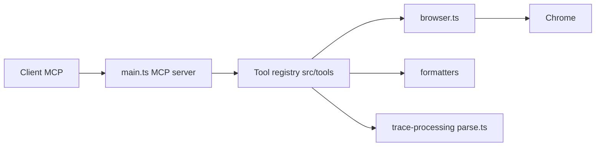

# ChromeDevTools/chrome-devtools-mcp

> MCP and CLI server that allows an agent to control and inspect a real Chrome instance via DevTools.

## The problem
A code agent writes pages without being able to see them in action: without any performance metrics, a console, or network requests.

## What it actually does
Chrome Pilot with Puppeteer: navigation, clicks, screenshots, console messages with source-mapped stack traces, network requests, performance traces. It also provides a CLI `chrome-devtools` and skills (a11y, LCP, memory leaks, cookies). The `--slim` mode reduces the set of tools. The code organizes a tool registry, a browser controller, and output formatters.

## How it is wired


## Trying it
```bash
npm i chrome-devtools-mcp@latest -g
chrome-devtools navigate_page 1 --url "https://developers.chrome.com"
chrome-devtools take_screenshot 1 --filePath screenshot.png
```

## Cost and gotchas
Free. The browser's content is exposed to the MCP client: to avoid sensitive data. Default Google usage statistics are enabled (`--no-usage-statistics`), CrUX requests for performance (`--no-performance-crux`), and npm update checks.

## What it is not
This is not a load testing environment. Only Chrome and Chrome for Testing are officially supported; other Chromium-based browsers are not guaranteed to work.

## Alternatives
No alternative is specified in the README.

## For you
To use: for debugging or measuring web dashboards with an agent, it is the official tool of the DevTools team; disable telemetry if the data requires it.
