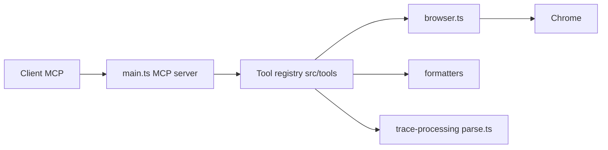

# ChromeDevTools/chrome-devtools-mcp

> Serveur MCP et CLI qui laissent un agent contrôler et inspecter un Chrome réel via DevTools.

## Le problème
Un agent de code écrit des pages sans pouvoir les voir tourner : ni trace de performance, ni console, ni requêtes réseau.

## Ce que ça fait vraiment
Pilote Chrome avec Puppeteer : navigation, clics, captures d'écran, messages console avec stack traces source-mappées, requêtes réseau, traces de performance. Fournit aussi un CLI `chrome-devtools` et des skills (a11y, LCP, fuites mémoire, cookies). Le mode `--slim` réduit le jeu d'outils. Le code organise un registre d'outils, un contrôleur de navigateur et des formateurs de sortie.

## Comment c'est branché


## Essayer
```bash
npm i chrome-devtools-mcp@latest -g
chrome-devtools navigate_page 1 --url "https://developers.chrome.com"
chrome-devtools take_screenshot 1 --filePath screenshot.png
```

## Coût et pièges
Gratuit. Le contenu du navigateur est exposé au client MCP : éviter les données sensibles. Statistiques d'usage Google actives par défaut (`--no-usage-statistics`), requêtes CrUX pour la performance (`--no-performance-crux`), vérification de mises à jour npm.

## Ce que ce n'est pas
Pas un banc de test de charge. Seuls Chrome et Chrome for Testing sont officiellement pris en charge ; les autres navigateurs Chromium ne sont pas garantis.

## Alternatives
Aucune alternative nommée dans le README.

## Pour toi
À adopter : pour déboguer ou mesurer des dashboards web avec un agent, c'est l'outil officiel de l'équipe DevTools ; désactive la télémétrie si les données le exigent.

