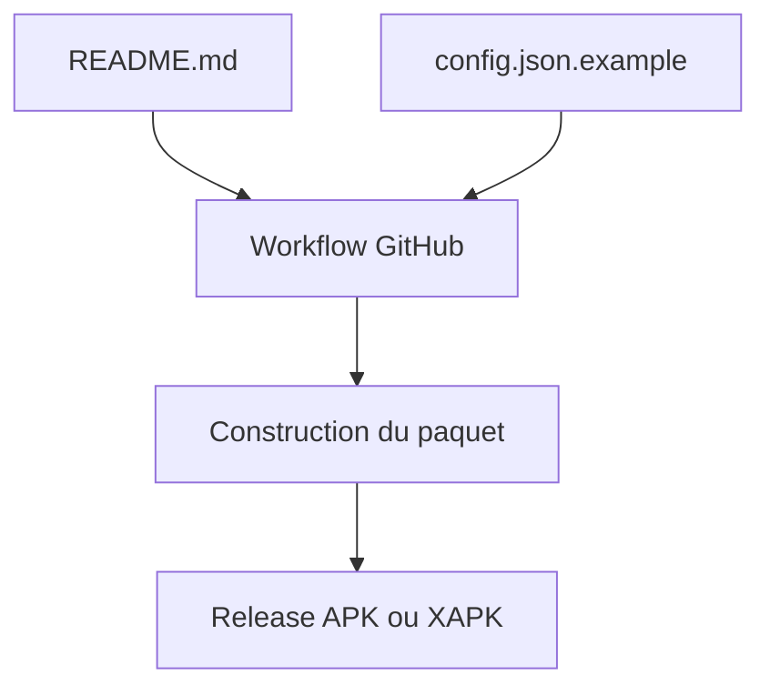

# Chtholly344/Azurlane-Build

> GitHub workflows that rebuild modified APK/XAPK packages of the game Azur Lane per regional server.

## The problem
Get a modified game package for a given region without building it by hand.

## What it actually does
The README describes three workflows (`main.yml` APK, `xapk.yml` XAPK, `generate-release.yml` as a multi-region matrix with release publishing), a `merge_build.sh` script and a test signing key. `config.json.example` serves as a region template. The provided tree contains almost no code.

## How it is wired


## Trying it
```bash
# Aucune commande documentée : le README décrit les workflows GitHub Actions.
```

## Cost and gotchas
A GitHub account to run the workflows. Risk of a game account ban, signature different from the original (third-party login broken). KR and HW servers flagged as faulty and not fixed. The README asks you to delete the files within 24 hours.

## What it is not
Not a data tool or an official launcher. What exactly the build modifies is not documented.

## Alternatives
JMBQ01/azurlan and n0k0m3/PerseusCI: cited as related repositories.

## For you
Ignore: mobile game modding with legal and account risk, unrelated to your job.
