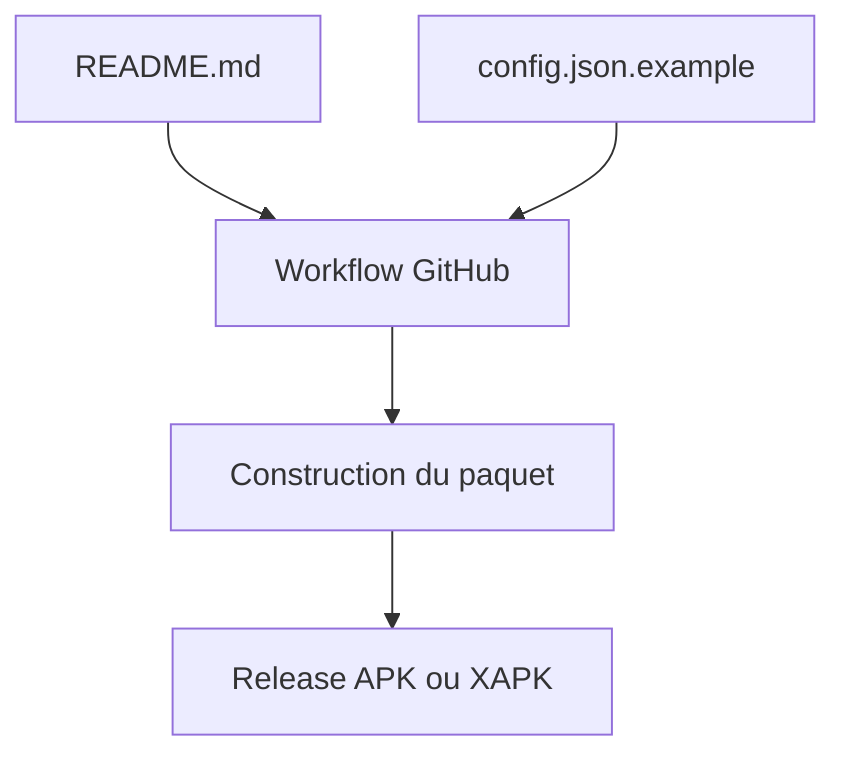

# Chtholly344/Azurlane-Build

> Workflows GitHub qui reconstruisent des paquets APK/XAPK modifiés du jeu Azur Lane par serveur régional.

## Le problème
Obtenir un paquet modifié du jeu pour une région donnée sans le construire à la main.

## Ce que ça fait vraiment
Le README décrit trois workflows (`main.yml` APK, `xapk.yml` XAPK, `generate-release.yml` en matrice multirégion avec publication de release), un script `merge_build.sh` et une clé de signature de test. `config.json.example` sert de modèle de régions. L'arbre fourni contient presque pas de code.

## Comment c'est branché


## Essayer
```bash
# Aucune commande documentée : le README décrit les workflows GitHub Actions.
```

## Coût et pièges
Un compte GitHub pour lancer les workflows. Risque de bannissement du compte de jeu, signature différente de l'original (connexion tierce cassée). Serveurs KR et HW signalés comme défaillants et non corrigés. Le README demande de supprimer les fichiers sous 24 heures.

## Ce que ce n'est pas
Pas un outil data ni un lanceur officiel. Ce que modifie exactement la construction n'est pas documenté.

## Alternatives
JMBQ01/azurlan et n0k0m3/PerseusCI : cités comme dépôts liés.

## Pour toi
Ignorer : modding de jeu mobile à risque juridique et de compte, sans lien avec ton métier.

