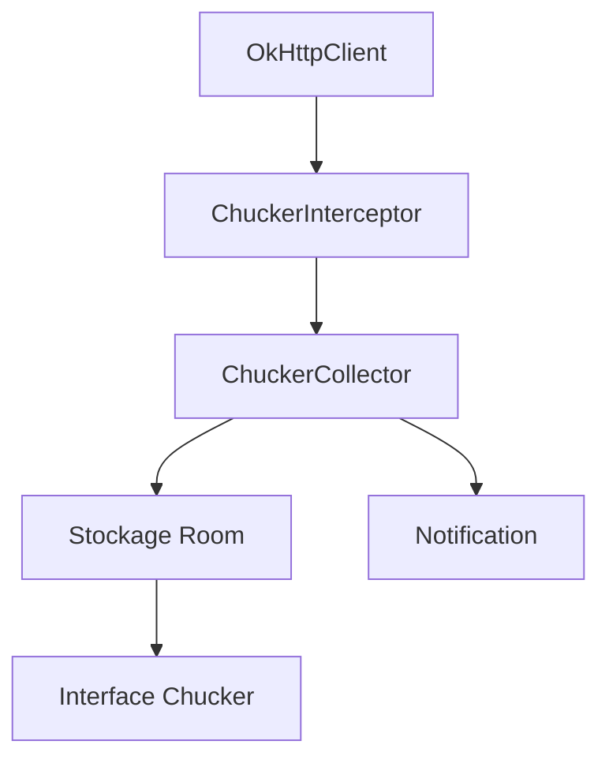

# ChuckerTeam/chucker

> OkHttp interceptor that records and displays the HTTP requests of an Android application under development.

## The problem
Debugging an Android application's network calls means going through an external proxy or digging through logs.

## What it actually does
An OkHttp interceptor stores requests and responses in the application (Room database) and shows a notification that opens an inspection interface: search in bodies, images, custom decoders (Protobuf for example), header masking. The `library-no-op` variant leaves the release build empty.

## How it is wired
Simplified diagram based on the sheet, no diagram provided.



## Trying it
```bash
# build.gradle du module app
# debugImplementation "com.github.chuckerteam.chucker:library:4.2.0"
# releaseImplementation "com.github.chuckerteam.chucker:library-no-op:4.2.0"
./gradlew build
```

## Cost and gotchas
Free, distributed via Maven Central. Stored data may contain tokens and cookies: development use only. Android 13 asks for the notification permission.

## What it is not
Not a tool for production requests, nor for platforms other than Android with OkHttp. Redirects and retries are not always captured separately.

## Alternatives
No alternative named in the README (Chuck, of which it is a fork, is cited for migration).

## For you
Ignore: an Android debugging tool unrelated to data, AI or MLOps.
