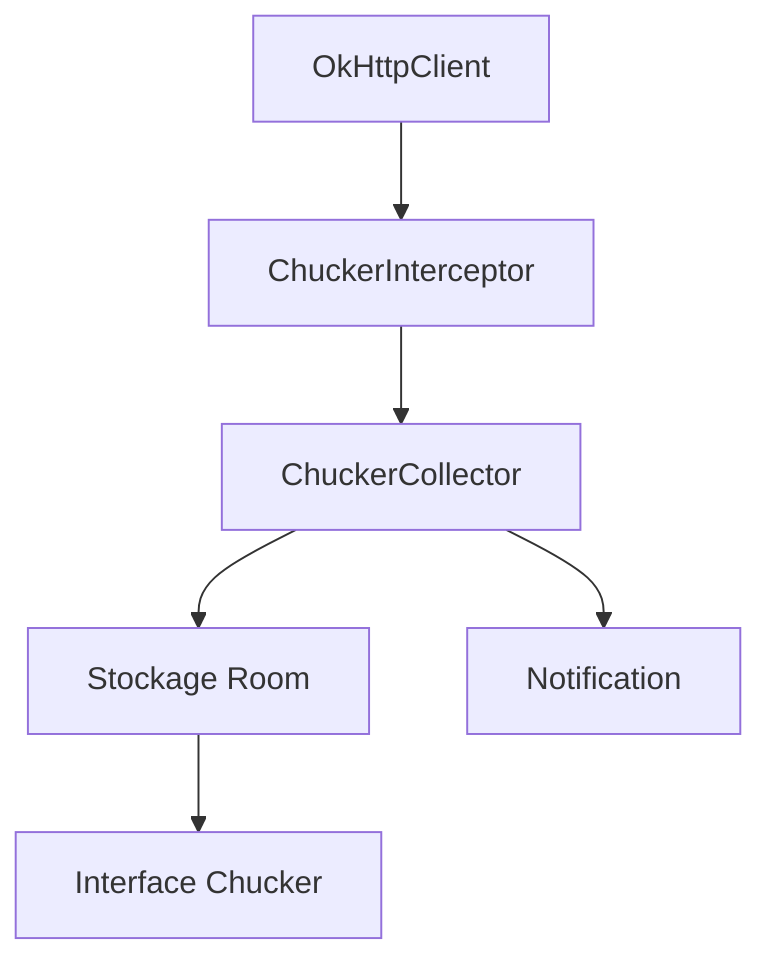

# ChuckerTeam/chucker

> Intercepteur OkHttp qui enregistre et affiche les requêtes HTTP d'une application Android en développement.

## Le problème
Déboguer les appels réseau d'une application Android oblige à passer par un proxy externe ou à fouiller les logs.

## Ce que ça fait vraiment
Un intercepteur OkHttp stocke requêtes et réponses dans l'application (base Room) et affiche une notification ouvrant une interface d'inspection : recherche dans les corps, images, décodeurs personnalisés (Protobuf par exemple), masquage d'en-têtes. La variante `library-no-op` laisse la version de release vide.

## Comment c'est branché
Schéma simplifié d'après la fiche, sans diagramme fourni.



## Essayer
```bash
# build.gradle du module app
# debugImplementation "com.github.chuckerteam.chucker:library:4.2.0"
# releaseImplementation "com.github.chuckerteam.chucker:library-no-op:4.2.0"
./gradlew build
```

## Coût et pièges
Gratuit, distribué via Maven Central. Les données stockées peuvent contenir des jetons et cookies : usage en développement uniquement. Android 13 demande la permission de notification.

## Ce que ce n'est pas
Pas un outil pour les requêtes en production, ni pour d'autres plateformes qu'Android avec OkHttp. Les redirections et réessais ne sont pas toujours capturés séparément.

## Alternatives
Aucune alternative nommée dans le README (Chuck, dont il est le fork, est cité pour la migration).

## Pour toi
À ignorer : outil de débogage Android sans lien avec la data, l'IA ou le MLOps.

