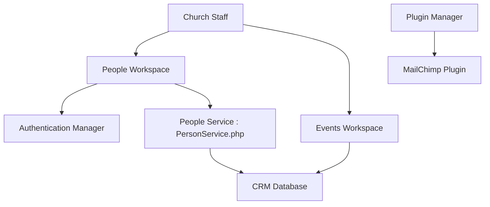

# ChurchCRM/CRM

> Free, self-hosted web application for church management: people, groups, events, donations.

## The problem
A church needs to track members, families, attendance and donations without a subscription or data held by a third party.

## What it actually does
Manages people and families, groups, events with attendance, financial tracking, volunteers and reports. Adds public registration, check-in kiosks, search, backup, updates, plugins and a MailChimp link. The code is in PHP, with a database and per-domain services.

## How it is wired

## Trying it
No command documented in the README: it points to the documentation, the `churchcrm/crm` Docker images and DEVELOPING.md.

## Cost and gotchas
Free, with hosting at your own expense. Docker images for amd64 and arm64. Members' sensitive data is your responsibility.

## What it is not
It is not a hosted service: you install and maintain it. The Softaculous demo is temporary, with fictitious data only.

## Alternatives
No alternative named in the README.

## For you
Ignore: association management application unrelated to data / AI / MLOps work.
