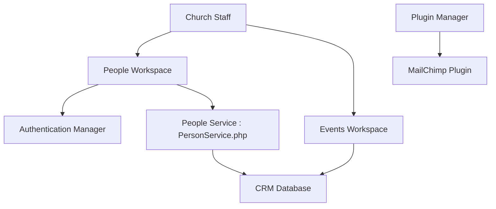

# ChurchCRM/CRM

> Application web libre et auto-hébergée de gestion d'église : personnes, groupes, événements, dons.

## Le problème
Une église a besoin de suivre fidèles, familles, présences et dons sans abonnement ni données chez un tiers.

## Ce que ça fait vraiment
Gère les personnes et les familles, les groupes, les événements avec présences, le suivi financier, les bénévoles et les rapports. Ajoute inscription publique, bornes de pointage, recherche, sauvegarde, mises à jour, plugins et lien MailChimp. Le code est en PHP, avec une base de données et des services par domaine.

## Comment c'est branché

## Essayer
Aucune commande documentée dans le README : il renvoie à la documentation, aux images Docker `churchcrm/crm` et à DEVELOPING.md.

## Coût et pièges
Gratuit, avec hébergement à ta charge. Images Docker pour amd64 et arm64. Les données sensibles de fidèles sont sous ta responsabilité.

## Ce que ce n'est pas
Ce n'est pas un service hébergé : tu l'installes et le maintiens. La démo Softaculous est temporaire, avec des données fictives uniquement.

## Alternatives
Aucune alternative nommée dans le README.

## Pour toi
À ignorer : application de gestion associative sans lien avec un travail data / IA / MLOps.

