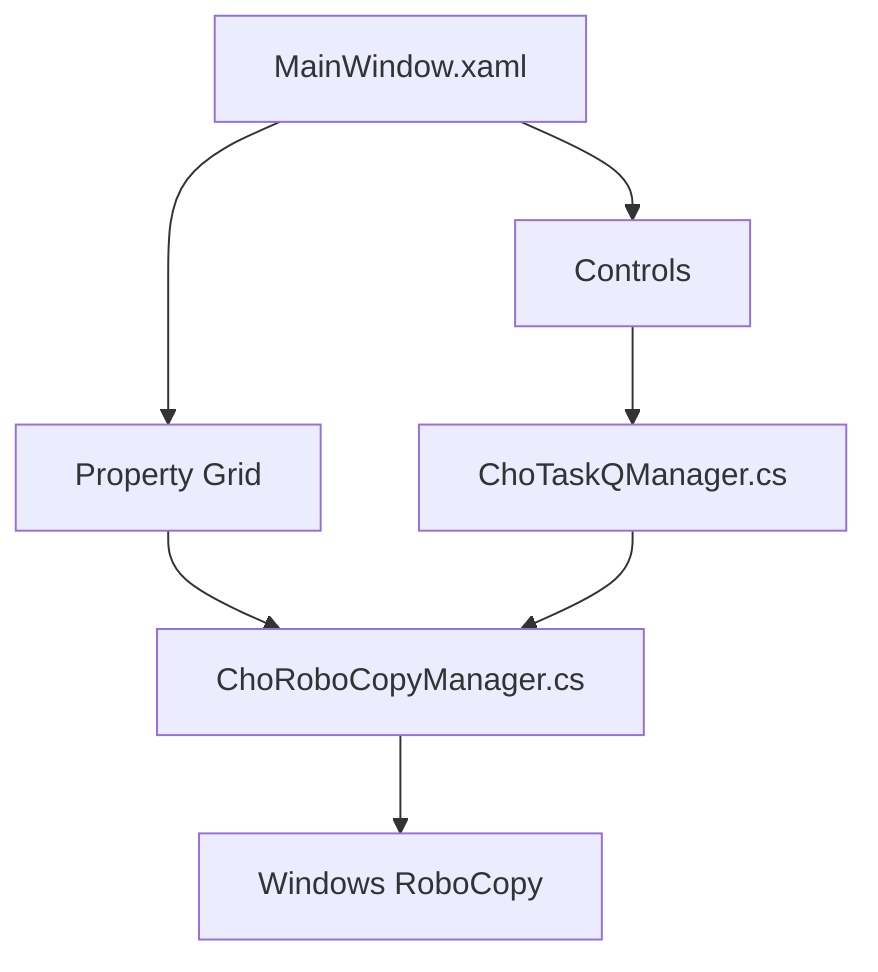

# Cinchoo/ChoEazyCopy

> Windows graphical interface for RoboCopy, for people who prefer clicking over typing options.

## The problem
RoboCopy is powerful but is driven from the command line with many options that are hard to remember.

## What it actually does
Builds RoboCopy options in a property grid, shows the generated command and immediate hints, saves reusable profiles, runs several instances and runs from the notification area. Execution happens inside the interface. From the code: a WPF application with a RoboCopy manager, a task queue and user preferences.

## How it is wired


## Trying it
```bash
# Télécharger le zip depuis https://github.com/Cinchoo/ChoEazyCopy/releases
# Décompresser (ex. c:\ChoEazyCopy) puis lancer ChoEazyCopy.exe
```

## Cost and gotchas
Free, optional donation. Requires .NET Framework 4, 4.5.2 or 4.8 and RoboCopy.exe in the system path (or specified in the tool). Windows only.

## What it is not
Not a new copy tool: it drives RoboCopy without replacing it. Not cross-platform.

## Alternatives
No alternative named in the README.

## For you
Ignore: a Windows file-copy utility with no link to data/AI/MLOps work.
