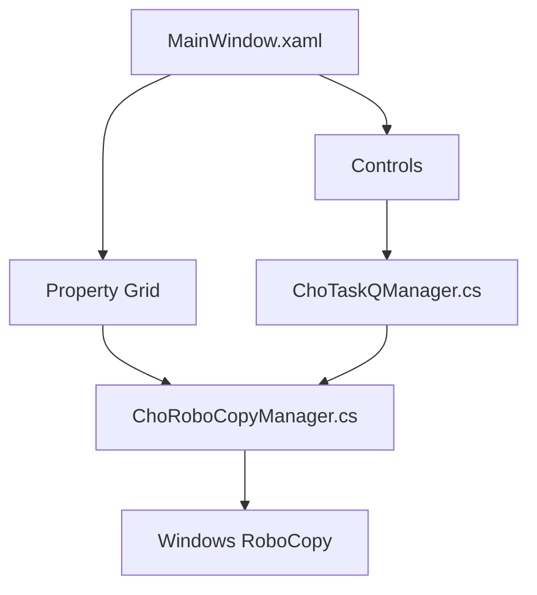

# Cinchoo/ChoEazyCopy

> Interface graphique Windows pour RoboCopy, pour qui préfère cliquer plutôt que taper des options.

## Le problème
RoboCopy est puissant mais se pilote en ligne de commande avec de nombreuses options difficiles à mémoriser.

## Ce que ça fait vraiment
Compose les options de RoboCopy dans une grille de propriétés, affiche la commande générée et des indications immédiates, enregistre des profils réutilisables, lance plusieurs instances et tourne depuis la zone de notification. L'exécution se fait dans l'interface. D'après le code : application WPF avec gestionnaire RoboCopy, file de tâches et préférences utilisateur.

## Comment c'est branché


## Essayer
```bash
# Télécharger le zip depuis https://github.com/Cinchoo/ChoEazyCopy/releases
# Décompresser (ex. c:\ChoEazyCopy) puis lancer ChoEazyCopy.exe
```

## Coût et pièges
Gratuit, don facultatif. Nécessite .NET Framework 4, 4.5.2 ou 4.8 et RoboCopy.exe dans le chemin système (ou à indiquer dans l'outil). Windows uniquement.

## Ce que ce n'est pas
Pas un nouvel outil de copie : il pilote RoboCopy sans le remplacer. Pas multiplateforme.

## Alternatives
Aucune alternative nommée dans le README.

## Pour toi
À ignorer : utilitaire Windows de copie de fichiers sans lien avec un travail data/IA/MLOps.

