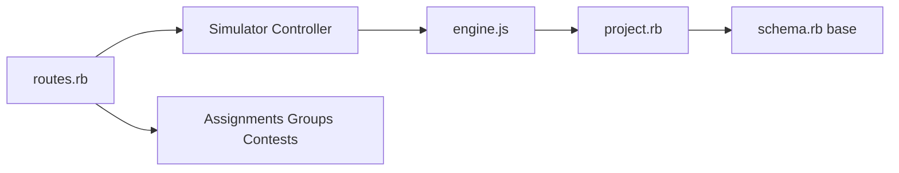

# CircuitVerse/CircuitVerse

> Free web platform for building and simulating logic circuits, with an interactive book.

## The problem
Learning digital circuits requires a simulator that is accessible in the browser and shareable in class.

## What it actually does
Rails application: JavaScript simulator, saved and shareable projects, search, groups, assignments, comments, contests, notifications. A Yosys service and Slack notifications complete the whole. The README points to `SETUP.md`, a getting-started video and BrowserStack.

## How it is wired

## Trying it
No command in the README; see `SETUP.md` (not provided here).

## Cost and gotchas
Installation not detailed in the README; the video mentions GitHub Codespaces. 987 open issues.

## What it is not
Not a professional chip design tool: it is an educational tool.

## Alternatives
No alternative named in the README.

## For you
Ignore: digital electronics education, unrelated to a data, AI or MLOps workflow.
