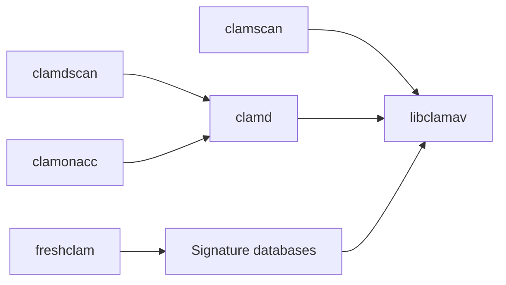

# Cisco-Talos/clamav

> Open source antivirus engine with a daemon, a command-line scanner and signature updates.

## The problem
Detecting trojans, viruses and malicious files in files, mail streams or disk accesses.

## What it actually does
`libclamav` analyzes formats (PE, PDF, Office, archives…), signatures and bytecode, with part of it written in Rust. Around it: `clamd` (daemon), `clamscan` (direct), `clamdscan` (client), `clamonacc` (file access), `clamav-milter` (MTA), `freshclam` (updates), `sigtool`. RAR support is loaded at runtime for licensing reasons.

## How it is wired

## Trying it
The README points to docs.clamav.net, the Docker Hub images and the packages. No commands in the README.

## Cost and gotchas
Free. Third-party components under different licenses; UnRAR is non-free, loaded separately. 413 open issues.

## What it is not
Not full endpoint protection (EDR). Detection is signature-based.

## Alternatives
No alternative named in the README.

## For you
Worth watching for scanning files uploaded to an app or an ingestion pipeline; otherwise outside your stack.
