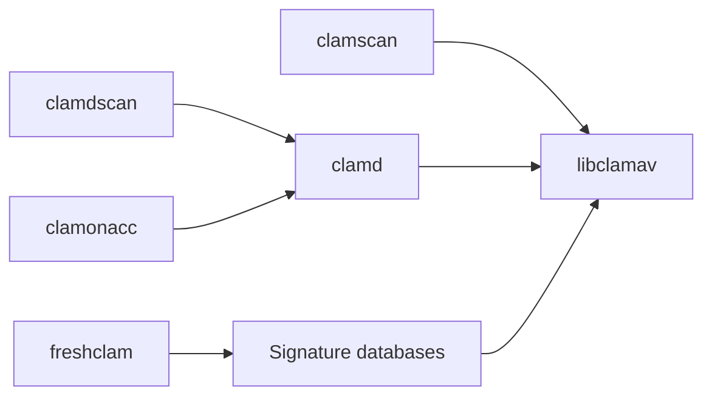

# Cisco-Talos/clamav

> Moteur antivirus open source avec démon, scanner en ligne de commande et mises à jour de signatures.

## Le problème
Détecter chevaux de Troie, virus et fichiers malveillants dans des fichiers, flux mail ou accès disque.

## Ce que ça fait vraiment
`libclamav` analyse formats (PE, PDF, Office, archives…), signatures et bytecode, avec une partie en Rust. Autour : `clamd` (démon), `clamscan` (direct), `clamdscan` (client), `clamonacc` (accès fichier), `clamav-milter` (MTA), `freshclam` (mises à jour), `sigtool`. Le support RAR est chargé à l'exécution pour raison de licence.

## Comment c'est branché

## Essayer
Le README renvoie à docs.clamav.net, aux images Docker Hub et aux paquets. Aucune commande dans le README.

## Coût et pièges
Gratuit. Composants tiers sous licences différentes ; UnRAR non libre, chargé à part. 413 issues ouvertes.

## Ce que ce n'est pas
Pas une protection de poste complète (EDR). Détection basée sur signatures.

## Alternatives
Aucune alternative nommée dans le README.

## Pour toi
À surveiller pour scanner des fichiers déposés dans une appli ou un pipeline d'ingestion ; sinon hors de ta pile.

