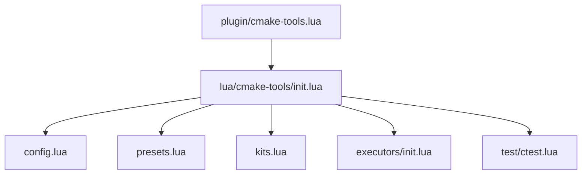

# Civitasv/cmake-tools.nvim

> Neovim plugin in Lua to drive CMake projects, comparable to vscode-cmake-tools.

## The problem
Generating, building and testing a CMake project from Neovim takes many manual commands.

## What it actually does
Manages CMake presets, kits and variants, then generates, builds, runs and tests through executors and runners (quickfix, toggleterm, overseer, terminal) and ctest. A session file keeps per-project settings.

## How it is wired


## Trying it
```bash
# lazy.nvim : return { 'Civitasv/cmake-tools.nvim', opts = {} }
# Aucune commande shell dans le README.
```

## Cost and gotchas
Neovim 0.7 or later and plenary. Global settings do not change projects that already have a session file. CMake must be installed.

## What it is not
Not a build system: it wraps CMake and ctest.

## Alternatives
- neovim-cmake (of which it is a fork).
- vscode-cmake-tools (the reference on the Visual Studio Code side).

## For you
Ignore: only useful for C or C++ under CMake in Neovim.
