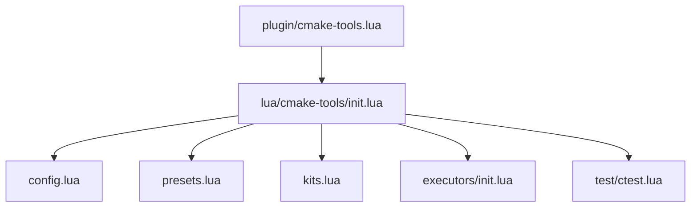

# Civitasv/cmake-tools.nvim

> Plugin Neovim en Lua pour piloter les projets CMake, comparable à vscode-cmake-tools.

## Le problème
Générer, compiler et tester un projet CMake depuis Neovim demande beaucoup de commandes manuelles.

## Ce que ça fait vraiment
Gère presets, kits et variants CMake, puis génère, compile, lance et teste via des executors et runners (quickfix, toggleterm, overseer, terminal) et ctest. Un fichier de session garde les réglages par projet.

## Comment c'est branché


## Essayer
```bash
# lazy.nvim : return { 'Civitasv/cmake-tools.nvim', opts = {} }
# Aucune commande shell dans le README.
```

## Coût et pièges
Neovim 0.7 ou plus et plenary. Les réglages globaux ne changent pas les projets ayant déjà un fichier de session. CMake doit être installé.

## Ce que ce n'est pas
Pas un système de build : il enveloppe CMake et ctest.

## Alternatives
- neovim-cmake (dont il est un fork).
- vscode-cmake-tools (référence côté Visual Studio Code).

## Pour toi
À ignorer : utile seulement pour du C ou C++ sous CMake dans Neovim.

