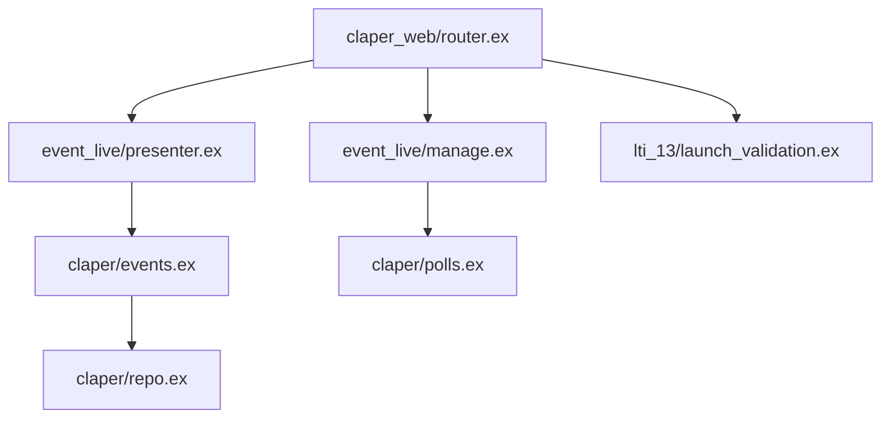

# ClaperCo/Claper

> Self-hostable alternative to Slido and Mentimeter: questions, polls and quizzes on your existing slides.

## The problem
Audience interaction tools are paid services that keep the audience's data.

## What it actually does
You upload a PDF or PPT(X), add Q&A, polls, quizzes, forms, reactions and live captions, and the audience joins from their phone without an account. CSV exports, OpenID Connect SSO, LTI 1.3 for Moodle, an admin panel. Phoenix LiveView, PostgreSQL and Oban.

## How it is wired


## Trying it
```bash
git clone https://github.com/ClaperCo/Claper.git && cd Claper
cp .env.sample .env
sed -i.bak "s|^SECRET_KEY_BASE=.*|SECRET_KEY_BASE=$(openssl rand -base64 48)|" .env
docker compose up -d
```

## Cost and gotchas
Free when self-hosted; the cloud offer is free up to 10 participants, then paid per event. The default administrator account (admin@claper.co / claper) must be changed at first login. Captions require your own Mistral key.

## What it is not
Not a slide editor. AGPL-3.0 license: if you modify and expose the service, you must publish your changes.

## Alternatives
Slido, Mentimeter, Wooclap and AhaSlides (the services it replaces, cited in the README).

## For you
Watch: useful for running an internal training or seminar while keeping the data at home, but outside the direct data/AI scope.
