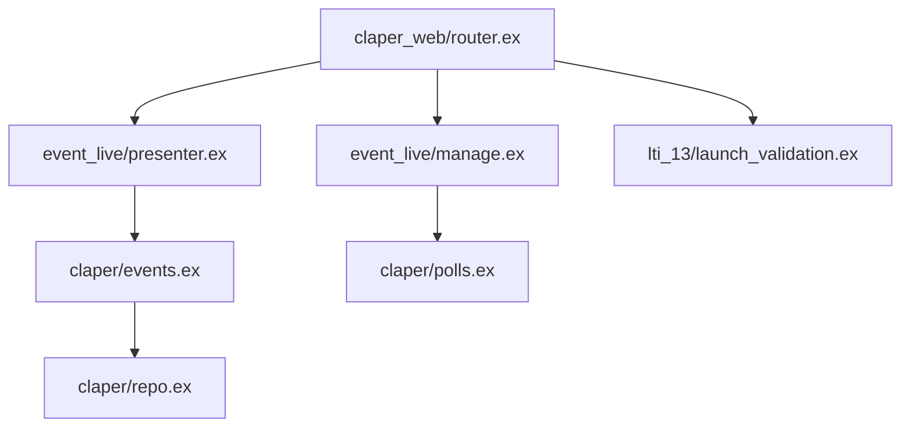

# ClaperCo/Claper

> Alternative auto-hébergeable à Slido et Mentimeter : questions, sondages et quiz sur tes diapositives existantes.

## Le problème
Les outils d'interaction avec le public sont des services payants qui gardent les données d'audience.

## Ce que ça fait vraiment
Tu téléverses un PDF ou PPT(X), tu ajoutes questions-réponses, sondages, quiz, formulaires, réactions et sous-titres en direct, et le public rejoint depuis son téléphone sans compte. Exports CSV, SSO OpenID Connect, LTI 1.3 pour Moodle, panneau d'administration. Phoenix LiveView, PostgreSQL et Oban.

## Comment c'est branché


## Essayer
```bash
git clone https://github.com/ClaperCo/Claper.git && cd Claper
cp .env.sample .env
sed -i.bak "s|^SECRET_KEY_BASE=.*|SECRET_KEY_BASE=$(openssl rand -base64 48)|" .env
docker compose up -d
```

## Coût et pièges
Gratuit en auto-hébergement ; l'offre cloud est gratuite jusqu'à 10 participants puis payante par événement. Le compte administrateur par défaut (admin@claper.co / claper) est à changer au premier login. Les sous-titres demandent ta propre clé Mistral.

## Ce que ce n'est pas
Pas un éditeur de diapositives. Licence AGPL-3.0 : si tu modifies et exposes le service, tu dois publier tes changements.

## Alternatives
Slido, Mentimeter, Wooclap et AhaSlides (les services remplacés, cités dans le README).

## Pour toi
Surveiller : utile pour animer une formation ou un séminaire interne en gardant les données chez toi, mais hors périmètre data/IA direct.

