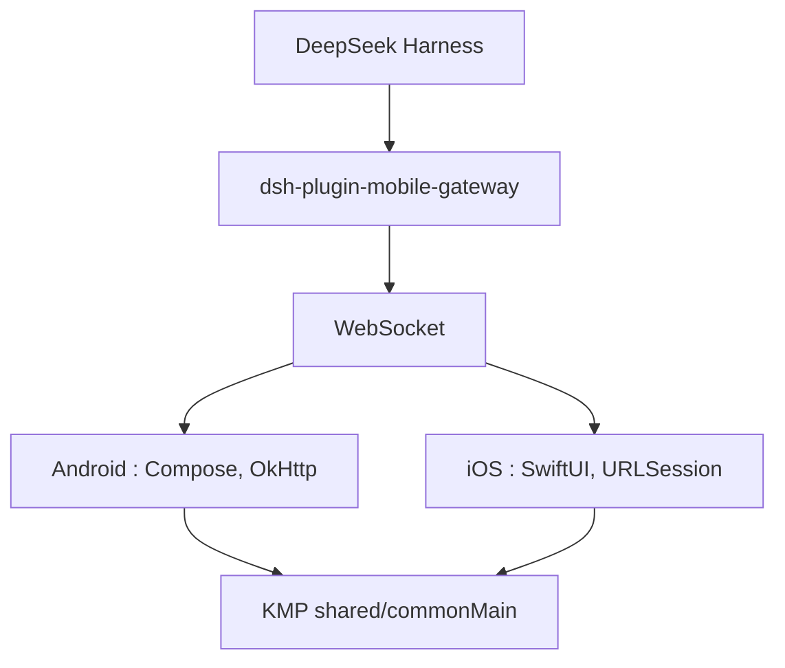

# Clarklevis1995/dsh-mobile

> Third-party mobile client (Android, iOS) for DeepSeek Harness, with shared logic in Kotlin Multiplatform.

## The problem
DeepSeek Harness runs on a desktop machine, with no practical access to its conversations and agents from a phone.

## What it actually does
The app connects over WebSocket to `dsh-plugin-mobile-gateway` to display workspaces, live conversations, agent traces, plugins, scheduled tasks and files. It handles tool approvals, voice input, file upload and QR code pairing. The common logic lives in the Kotlin `shared` module.

## How it is wired


## Trying it
```bash
dsh plugin --profile web add dsh-plugin-mobile-gateway@latest
./gradlew :androidApp:assembleDebug
./gradlew :androidApp:installDebug
adb reverse tcp:3080 tcp:3080
```

## Cost and gotchas
Requires DeepSeek Harness with gateway 0.11.2 or later. Building requires Java 17, Android SDK 36, and for iOS a Mac with Xcode 26. Use `wss://` outside a trusted network.

## What it is not
Not an official client: an independent project. Not usable without the desktop Harness. On iOS, background connection is not guaranteed.

## Alternatives
No alternative cited in the README.

## For you
Ignore unless you already use DeepSeek Harness: it is a client that depends on a third-party product, maintained by a single person.
