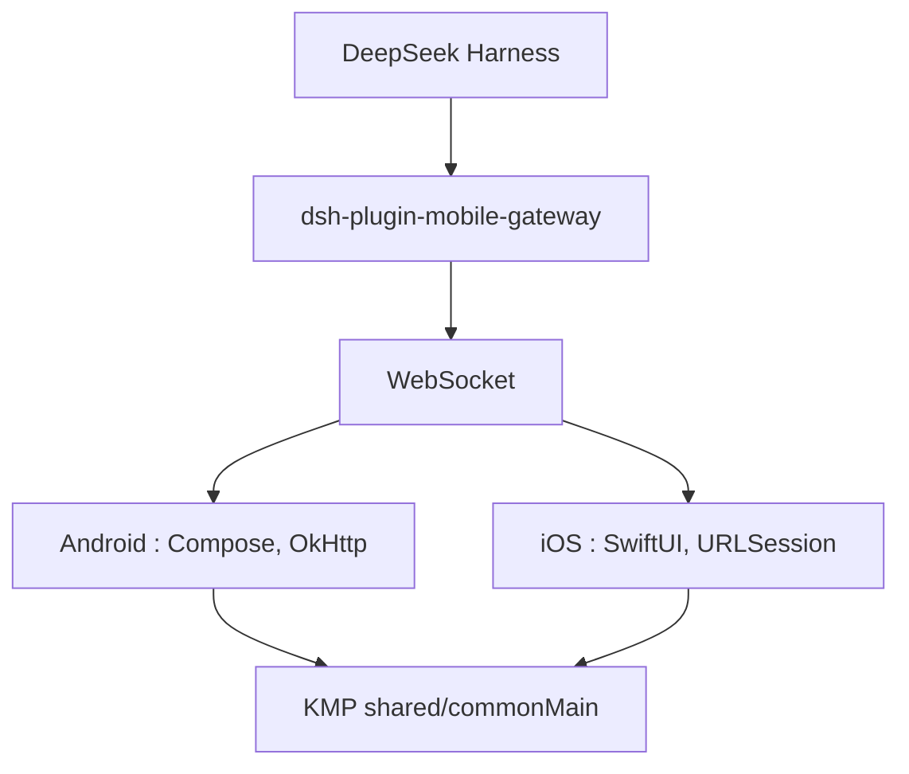

# Clarklevis1995/dsh-mobile

> Client mobile tiers (Android, iOS) pour DeepSeek Harness, avec logique partagée en Kotlin Multiplatform.

## Le problème
DeepSeek Harness tourne sur un poste de bureau, sans accès pratique à ses conversations et agents depuis un téléphone.

## Ce que ça fait vraiment
L'application se connecte par WebSocket à `dsh-plugin-mobile-gateway` pour afficher espaces de travail, conversations en direct, traces d'agents, plugins, tâches planifiées et fichiers. Elle gère approbations d'outils, saisie vocale, envoi de fichiers et appairage par QR code. La logique commune est dans le module `shared` Kotlin.

## Comment c'est branché


## Essayer
```bash
dsh plugin --profile web add dsh-plugin-mobile-gateway@latest
./gradlew :androidApp:assembleDebug
./gradlew :androidApp:installDebug
adb reverse tcp:3080 tcp:3080
```

## Coût et pièges
Il faut DeepSeek Harness avec la passerelle 0.11.2 ou plus. Compiler demande Java 17, Android SDK 36, et pour iOS macOS avec Xcode 26. Utilise `wss://` hors réseau de confiance.

## Ce que ce n'est pas
Pas un client officiel : projet indépendant. Pas utilisable sans le Harness de bureau. Sur iOS, la connexion en arrière-plan n'est pas garantie.

## Alternatives
Aucune alternative citée dans le README.

## Pour toi
À ignorer sauf si tu utilises déjà DeepSeek Harness : c'est un client dépendant d'un produit tiers, tenu par une seule personne.

