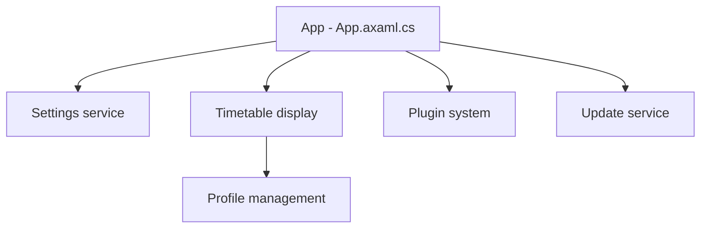

# ClassIsland/ClassIsland

> Timetable display tool for classroom screens, inspired by Dynamic Island, in Chinese.

## The problem
A class needs to display the timetable and lesson reminders on a shared screen.

## What it actually does
Displays the day's schedule and the current lesson, with sound and visual reminders, a schedule editor (Excel import/export, CSES), components (date, time, weather, countdown), plugins and themes, automations, weather, password protection, automatic updates. Windows 10+, macOS 11+ and Debian/X11; .NET 8 required on Windows. The README is in Chinese.

## How it is wired

## Trying it
No command in the README; installation via documentation and downloads.

## Cost and gotchas
Free. Incompatible with window material modification tools; Wayland not supported. Centralized management "coming soon". 381 open issues.

## What it is not
Not a complete school management tool: display and reminders.

## Alternatives
No alternative named in the README.

## For you
Ignore: a school utility unrelated to data/AI/MLOps.
