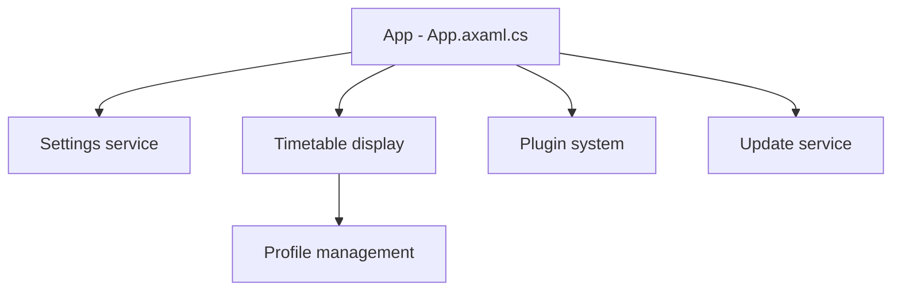

# ClassIsland/ClassIsland

> Outil d'affichage d'emploi du temps pour écrans de classe, inspiré du Dynamic Island, en chinois.

## Le problème
Une classe a besoin d'afficher l'emploi du temps et des rappels de cours sur un écran partagé.

## Ce que ça fait vraiment
Affiche le planning du jour et le cours en cours, avec rappels sonores et visuels, éditeur de planning (import/export Excel, CSES), composants (date, heure, météo, compte à rebours), plugins et thèmes, automatisations, météo, protection par mot de passe, mises à jour automatiques. Windows 10+, macOS 11+ et Debian/X11 ; .NET 8 requis sous Windows. Le README est en chinois.

## Comment c'est branché

## Essayer
Aucune commande dans le README ; installation via documentation et téléchargements.

## Coût et pièges
Gratuit. Incompatible avec les outils de modification de matériaux de fenêtre ; Wayland non pris en charge. Gestion centralisée « bientôt disponible ». 381 issues ouvertes.

## Ce que ce n'est pas
Pas un outil de gestion scolaire complet : affichage et rappels.

## Alternatives
Aucune alternative nommée dans le README.

## Pour toi
À ignorer : utilitaire scolaire sans rapport avec data/IA/MLOps.

