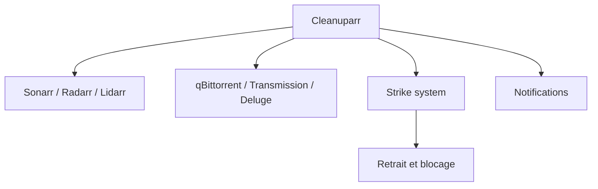

# Cleanuparr/Cleanuparr

> Download manager for the Servarr ecosystem: purges stalled or malicious downloads from Sonarr, Radarr and the like.

## The problem
Booby-trapped files (`*.lnk`, `*.zipx`) or stalled downloads stay stuck in the Sonarr/Radarr queues and require manual intervention.

## What it actually does
"Strikes" system: removes and blocks downloads that are stalled, slow, failing to import or matching malware patterns. Also runs searches for missing content and quality upgrades, cleans up torrents after seeding and orphaned files. Web interface, notifications.

## How it is wired
Simplified diagram based on the sheet, no diagram provided.


## Trying it
```bash
docker run -d --name cleanuparr \
  --restart unless-stopped \
  -p 11011:11011 \
  -v /path/to/config:/config \
  -e PORT=11011 \
  -e PUID=1000 \
  -e PGID=1000 \
  -e TZ=Etc/UTC \
  ghcr.io/cleanuparr/cleanuparr:latest
```
Interface at http://localhost:11011.

## Cost and gotchas
Free, self-hosted (Docker). Assumes an existing Sonarr/Radarr stack and a download client. A managed ElfHosted offering exists (7-day trial).

## What it is not
Not a general-purpose disk cleanup tool. Useless without the *arr ecosystem.

## Alternatives
ManiMatter/decluttarr, ThijmenGThN/swaparr and PaeyMoopy/sonarr-radarr-queue-cleaner, cited as sources of inspiration.

## For you
Ignore: unrelated to data / AI / MLOps work, useful only if you run a home *arr media library.
