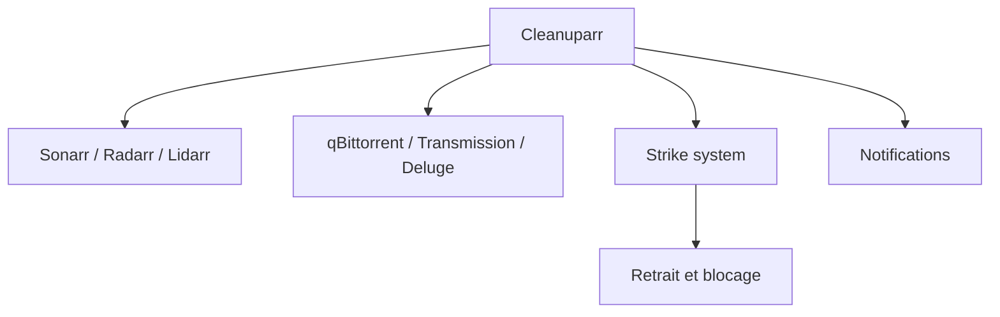

# Cleanuparr/Cleanuparr

> Gestionnaire de téléchargements pour l'écosystème Servarr : purge les téléchargements bloqués ou malveillants de Sonarr, Radarr et consorts.

## Le problème
Des fichiers piégés (`*.lnk`, `*.zipx`) ou des téléchargements bloqués restent coincés dans les files Sonarr/Radarr et demandent une intervention manuelle.

## Ce que ça fait vraiment
Système de « strikes » : retire et bloque les téléchargements bloqués, lents, en échec d'import ou correspondant à des motifs de malware. Lance aussi des recherches de contenus manquants et de mises à niveau de qualité, nettoie les torrents après seed et les fichiers orphelins. Interface web, notifications.

## Comment c'est branché
Schéma simplifié d'après la fiche, sans diagramme fourni.


## Essayer
```bash
docker run -d --name cleanuparr \
  --restart unless-stopped \
  -p 11011:11011 \
  -v /path/to/config:/config \
  -e PORT=11011 \
  -e PUID=1000 \
  -e PGID=1000 \
  -e TZ=Etc/UTC \
  ghcr.io/cleanuparr/cleanuparr:latest
```
Interface sur http://localhost:11011.

## Coût et pièges
Gratuit, auto-hébergé (Docker). Suppose déjà une pile Sonarr/Radarr et un client de téléchargement. Une offre gérée ElfHosted existe (essai 7 jours).

## Ce que ce n'est pas
Pas un outil généraliste de nettoyage de disque. Inutile sans l'écosystème *arr.

## Alternatives
ManiMatter/decluttarr, ThijmenGThN/swaparr et PaeyMoopy/sonarr-radarr-queue-cleaner, cités comme sources d'inspiration.

## Pour toi
Ignorer : sans rapport avec le travail data / IA / MLOps, utile seulement si tu gères une médiathèque *arr à domicile.

