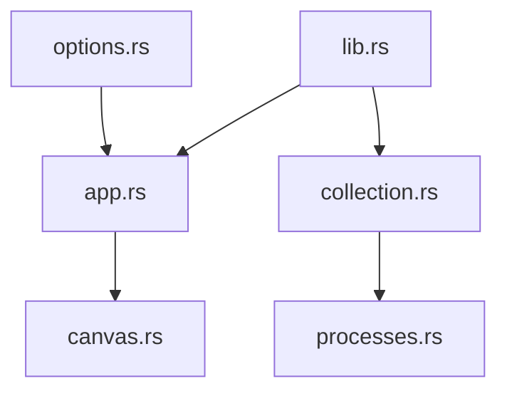

# ClementTsang/bottom

> Cross-platform, customizable terminal system and process monitor, inspired by htop.

## The problem
Monitoring CPU, memory, network, disks and processes often requires different tools depending on the OS.

## What it actually does
Displays CPU, RAM, network, temperature and disk graphs in the terminal, information widgets and a process table with search, sorting, tree mode and kill signals. Themes, layout and filters are set through options or a configuration file generated on first launch. Linux, macOS and Windows are officially supported.

## How it is wired


## Trying it
```bash
cargo install bottom --locked
brew install bottom
btm
```

## Cost and gotchas
Free. Many package managers are listed; the Fedora COPR package appears to be unmaintained according to the README.

## What it is not
Not a distributed monitoring tool: it watches a single machine. Unofficial platforms have limited support.

## Alternatives
- htop, gtop, gotop: cited as sources of inspiration, with no detailed comparison.

## For you
Adopt it to watch CPU, RAM and processes during local training runs or jobs, right in the terminal.
