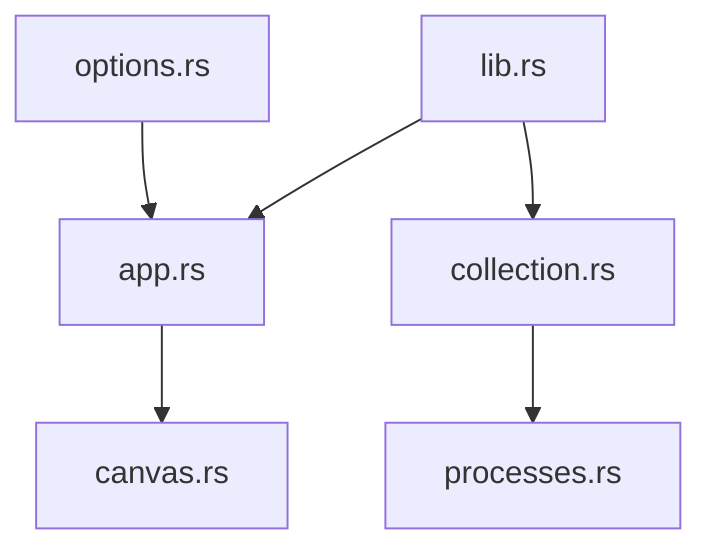

# ClementTsang/bottom

> Moniteur système et de processus en terminal, multiplateforme et personnalisable, inspiré de htop.

## Le problème
Surveiller CPU, mémoire, réseau, disques et processus demande souvent des outils différents selon l'OS.

## Ce que ça fait vraiment
Affiche en terminal des graphiques CPU, RAM, réseau, température et disque, des widgets d'information et un tableau de processus avec recherche, tri, mode arbre et signaux d'arrêt. Thèmes, disposition et filtres se règlent par options ou fichier de configuration généré au premier lancement. Linux, macOS et Windows sont officiellement pris en charge.

## Comment c'est branché


## Essayer
```bash
cargo install bottom --locked
brew install bottom
btm
```

## Coût et pièges
Gratuit. Beaucoup de gestionnaires de paquets sont listés ; le paquet COPR Fedora semble non maintenu d'après le README.

## Ce que ce n'est pas
Pas un outil de supervision distribuée : il surveille une seule machine. Les plateformes non officielles ont un support limité.

## Alternatives
- htop, gtop, gotop : cités comme sources d'inspiration, sans comparaison détaillée.

## Pour toi
À adopter pour surveiller CPU, RAM et processus pendant des entraînements ou des jobs locaux, directement en terminal.

