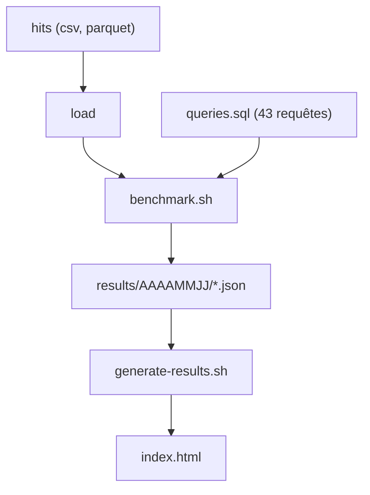

# ClickHouse/ClickBench

> Reproducible benchmark for analytical databases: a 100-million-row dataset and 43 queries.

## The problem
Comparing analytical databases without a common protocol yields unverifiable numbers.

## What it actually does
Provides a flat web analytics table (99,997,497 rows, anonymized), 43 queries in standard SQL, and one script per system that installs, loads, measures and outputs the timings. Each query is run three times (cold and hot). An online dashboard aggregates the results of more than 60 systems. Results come from AWS c6a.4xlarge VMs by default.

## How it is wired


Simplified diagram based on the fiche, no diagram provided.

## Trying it
```bash
# Copier un dossier de système existant, puis adapter :
# benchmark.sh, create.sql, queries.sql, run.sh
./generate-results.sh
```

## Cost and gotchas
A full run takes from 20 minutes to several hours on a paid cloud VM. A license is present but not identified by GitHub.

## What it is not
Not a neutral ranking: single table, sequential execution, no concurrency, and the README asks not to turn it into a league table. Created by the ClickHouse team.

## Alternatives
- mgbench (Brown University): machine logs, but a very small dataset and little maintenance.
- JSONBench: analytics on JSON data, included in this same repository.
- AMPLab Big Data Benchmark: coverage judged weak.

## For you
Worth watching: useful for choosing or justifying an analytical engine, but to be read with the limits stated by its own authors.
