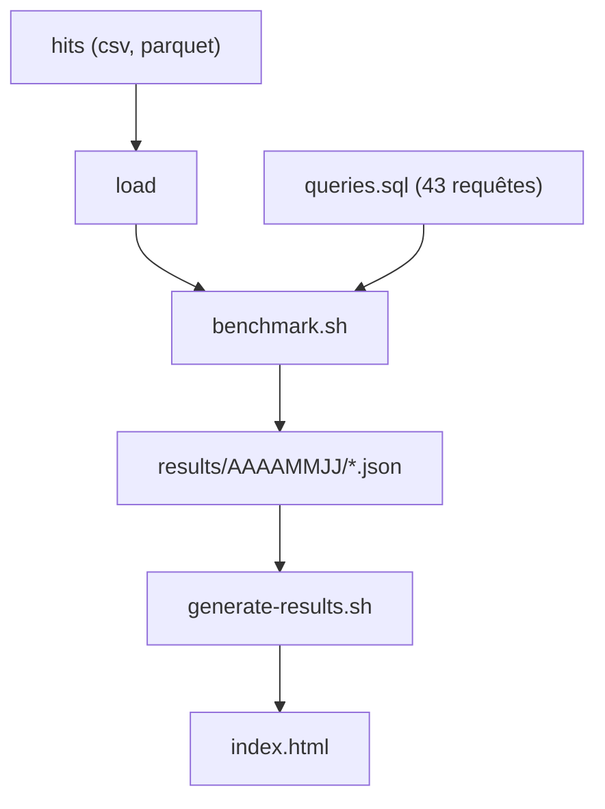

# ClickHouse/ClickBench

> Benchmark reproductible de bases analytiques : un jeu de données de 100 millions de lignes et 43 requêtes.

## Le problème
Comparer des bases analytiques entre elles sans protocole commun donne des chiffres invérifiables.

## Ce que ça fait vraiment
Fournit une table plate de web analytics (99 997 497 lignes, anonymisée), 43 requêtes en SQL standard et un script par système qui installe, charge, mesure et sort les temps. Chaque requête est lancée trois fois (froid et chaud). Un tableau de bord en ligne agrège les résultats de plus de 60 systèmes. Les résultats viennent de VM AWS c6a.4xlarge par défaut.

## Comment c'est branché


Schéma simplifié d'après la fiche, sans diagramme fourni.

## Essayer
```bash
# Copier un dossier de système existant, puis adapter :
# benchmark.sh, create.sql, queries.sql, run.sh
./generate-results.sh
```

## Coût et pièges
Une exécution complète prend de 20 minutes à plusieurs heures sur une VM cloud payante. La licence est présente mais non identifiée par GitHub.

## Ce que ce n'est pas
Pas un classement neutre : table unique, exécution séquentielle, pas de concurrence, et le README demande de ne pas en faire un palmarès. Créé par l'équipe ClickHouse.

## Alternatives
- mgbench (Brown University) : logs de machines, mais jeu de données très petit et peu maintenu.
- JSONBench : analytique sur données JSON, intégré à ce même dépôt.
- AMPLab Big Data Benchmark : couverture jugée faible.

## Pour toi
À surveiller : utile pour choisir ou justifier un moteur analytique, mais à lire avec les limites énoncées par ses propres auteurs.

