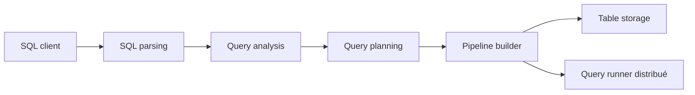

# ClickHouse/ClickHouse

> Open-source, column-oriented database for generating real-time analytical reports.

## The problem
The performance of line-by-line operations degrades as you aggregate billions of rows for dashboards or analyses.

## What it actually does
A client sends SQL queries, which are then analyzed, optimized, and executed through a query pipeline. Various storage engines (tables, BigQuery, object queues) are used, along with distributed execution across remote clusters, and a user query log. The README is primarily a portal for links, events, and job postings.

## How it is wired


## Trying it
```bash
curl https://clickhouse.com/ | sh
```

## Cost and gotchas
Free binary; ClickHouse Cloud is the paid service offered by the creators. Over 8,000 open issues. The README does not document queries or architecture.

## What it is not
Not a transactional database: it's for analytics. The README doesn't mention any limitations.

## Alternatives
No alternative is specified in the README file.

## For you
Suitable for large-scale analytics, for example, logs or features; please review the documentation (which is not summarized here) before using it in a production environment.
