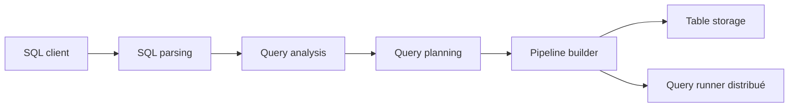

# ClickHouse/ClickHouse

> SGBD orienté colonnes open source pour produire des rapports analytiques en temps réel.

## Le problème
Les bases ligne par ligne ralentissent dès qu'on agrège des milliards de lignes pour des tableaux de bord ou des analyses.

## Ce que ça fait vraiment
Un client envoie du SQL, qui est analysé, planifié puis exécuté via un pipeline de requêtes. Moteurs de stockage variés (table, BigQuery, file d'attente d'objets), exécution distribuée sur clusters distants, journal de requêtes utilisateur. Le README est surtout un portail de liens, d'événements et d'offres d'emploi.

## Comment c'est branché


## Essayer
```bash
curl https://clickhouse.com/ | sh
```

## Coût et pièges
Binaire gratuit ; ClickHouse Cloud est le service payant des créateurs. Plus de 8 000 issues ouvertes. Le README ne documente ni requêtes ni architecture.

## Ce que ce n'est pas
Pas une base transactionnelle : c'est de l'analytique. Le README ne dit rien de ses limites.

## Alternatives
Aucune alternative nommée dans le README.

## Pour toi
À adopter pour l'analytique à grande échelle, par exemple logs ou features ; vérifier la doc (non résumée ici) avant de l'utiliser en production.

