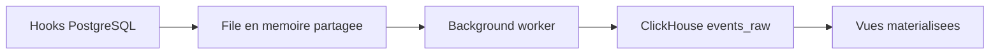

# ClickHouse/pg_stat_ch

> PostgreSQL extension that sends every executed query, as a raw event, to ClickHouse for analysis.

## The problem
pg_stat_statements aggregates inside PostgreSQL and loses the detail of each execution. It is impossible to derive fine percentiles or per-application time series from it.

## What it actually does
PostgreSQL hooks capture duration, rows, buffers, WAL, CPU, errors (SQLSTATE) and client context. Events go into a ring buffer in shared memory. A background process exports them in batches to the ClickHouse `events_raw` table, where materialized views and queries do the aggregation. If the queue overflows, events are dropped with counters, without blocking queries.

## How it is wired
Simplified diagram based on the sheet, no diagram provided.



## Trying it
```bash
./scripts/quickstart.sh up
./scripts/quickstart.sh check
./scripts/quickstart.sh down
```

## Cost and gotchas
Free, but you need a ClickHouse to host, PostgreSQL 16+ and a restart for `shared_preload_libraries`. Build with CMake and C++17 if you do not use the quickstart; schema applied with goose.

## What it is not
Not a dashboard: it only exports data, the analysis is yours to write in ClickHouse SQL. Not a turnkey replacement for pg_stat_statements, and query text is truncated to 2 KB.

## Alternatives
- pg_stat_statements: already in PostgreSQL, no stack to add, but aggregated only.

## For you
Watch: useful if you already analyze PostgreSQL load in ClickHouse, but the extension is young (created in January 2026) and requires a build.
