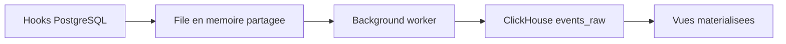

# ClickHouse/pg_stat_ch

> Extension PostgreSQL qui envoie chaque requête exécutée, en événement brut, vers ClickHouse pour l'analyse.

## Le problème
pg_stat_statements agrège dans PostgreSQL et perd le détail de chaque exécution. Impossible d'en tirer des percentiles fins ou des séries temporelles par application.

## Ce que ça fait vraiment
Des hooks PostgreSQL capturent durée, lignes, tampons, WAL, CPU, erreurs (SQLSTATE) et contexte client. Les événements vont dans un tampon circulaire en mémoire partagée. Un processus d'arrière-plan les exporte par lots vers la table `events_raw` de ClickHouse, où vues matérialisées et requêtes font l'agrégation. Si la file déborde, les événements sont abandonnés avec compteurs, sans bloquer les requêtes.

## Comment c'est branché
Schéma simplifié d'après la fiche, sans diagramme fourni.



## Essayer
```bash
./scripts/quickstart.sh up
./scripts/quickstart.sh check
./scripts/quickstart.sh down
```

## Coût et pièges
Gratuit, mais il faut un ClickHouse à héberger, PostgreSQL 16+ et un redémarrage pour `shared_preload_libraries`. Compilation avec CMake et C++17 si on n'utilise pas le quickstart ; schéma appliqué avec goose.

## Ce que ce n'est pas
Pas un tableau de bord : il n'exporte que des données, l'analyse est à écrire en SQL ClickHouse. Pas un remplaçant clés en main de pg_stat_statements, et le texte des requêtes est tronqué à 2 Ko.

## Alternatives
- pg_stat_statements : déjà dans PostgreSQL, sans stack à ajouter, mais agrégé seulement.

## Pour toi
Surveiller : utile si tu analyses déjà la charge PostgreSQL dans ClickHouse, mais l'extension est jeune (créée en janvier 2026) et demande une compilation.

