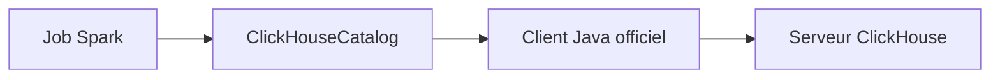

# ClickHouse/spark-clickhouse-connector

> Spark DataSourceV2 connector to read from and write to ClickHouse, for data teams.

## The problem
Getting Spark and ClickHouse to talk without going through exports or generic JDBC is slow to set up.

## What it actually does
Provides a Spark catalog (`com.clickhouse.spark.ClickHouseCatalog`) built on the DataSourceV2 API and the official ClickHouse Java client, over HTTP by default. Compatible with Spark 3.3, 3.4, 3.5 and 4.0, Scala 2.12 or 2.13. gRPC was removed in 0.8.0.

## How it is wired

Simplified diagram based on the sheet, no diagram provided.

## Trying it
```bash
./gradlew clean build -x test
./gradlew clean test
./gradlew clean test -Dspark_binary_version=3.3 -Dscala_binary_version=2.13
```

## Cost and gotchas
Free. Requires Java 8 or 17, Scala and a compatible Spark (the README gives the matrix). Tests require Docker and Docker Compose. Usage documentation is external to the README.

## What it is not
Not a Python client nor a turnkey ETL: it is a JVM component for Spark. The groupId change in 0.8.0 breaks old configurations.

## Alternatives
None named in the README.

## For you
If you move data from Spark to ClickHouse, this is the connector maintained by the vendor itself: adopt.
