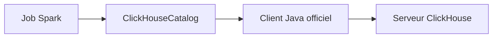

# ClickHouse/spark-clickhouse-connector

> Connecteur Spark DataSourceV2 pour lire et écrire dans ClickHouse, pour équipes data.

## Le problème
Faire dialoguer Spark et ClickHouse sans passer par des exports ou du JDBC générique est lent à mettre en place.

## Ce que ça fait vraiment
Fournit un catalogue Spark (`com.clickhouse.spark.ClickHouseCatalog`) bâti sur l'API DataSourceV2 et le client Java officiel ClickHouse, en HTTP par défaut. Compatible Spark 3.3, 3.4, 3.5 et 4.0, Scala 2.12 ou 2.13. Le gRPC a été retiré en 0.8.0.

## Comment c'est branché

Schéma simplifié d'après la fiche, sans diagramme fourni.

## Essayer
```bash
./gradlew clean build -x test
./gradlew clean test
./gradlew clean test -Dspark_binary_version=3.3 -Dscala_binary_version=2.13
```

## Coût et pièges
Gratuit. Il faut Java 8 ou 17, Scala et un Spark compatible (le README donne la matrice). Les tests exigent Docker et Docker Compose. La documentation d'usage est externe au README.

## Ce que ce n'est pas
Pas un client Python ni un ETL clef en main : c'est un composant JVM pour Spark. Le changement de groupId en 0.8.0 casse les anciennes configurations.

## Alternatives
Aucune nommée dans le README.

## Pour toi
Si tu fais passer des données de Spark vers ClickHouse, c'est le connecteur maintenu par l'éditeur lui-même : à adopter.

