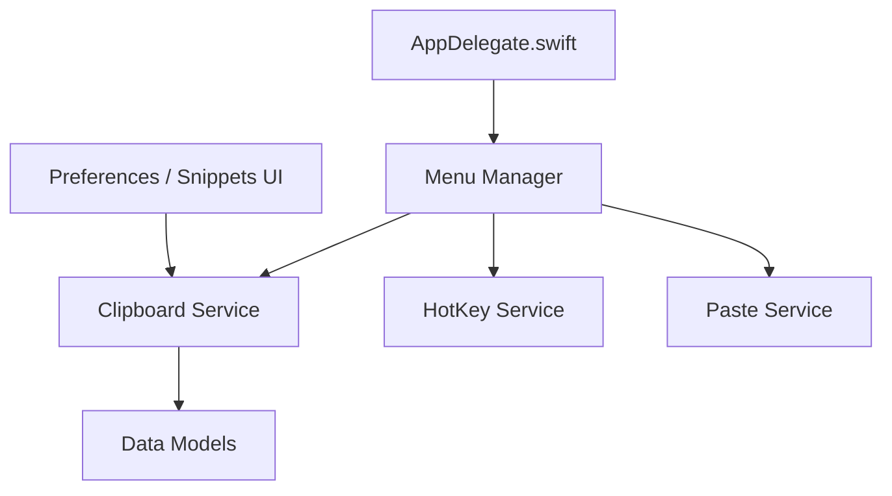

# Clipy/Clipy

> Clipboard extension for macOS, with history and text snippets, for Mac users.

## The problem
The macOS clipboard keeps only a single item; retrieving a text copied earlier is impossible.

## What it actually does
Menu bar application in Swift: clipboard history, snippet editor, keyboard shortcuts, automatic pasting via accessibility, localized preferences. According to the architecture described, separate services handle the clipboard, shortcuts, accessibility, pasting and data cleanup. Requires macOS 13 or later.

## How it is wired

## Trying it
The README gives no directly usable command. To build: open `Clipy.xcodeproj`, uncomment the inclusion of `CodeSigning-AdHoc.xcconfig` in `Configurations/CodeSigning.xcconfig`, then build the `Clipy` scheme.

## Cost and gotchas
Free. The default signing certificate is reserved for the maintainer: you have to switch to ad hoc signing, and macOS asks for Accessibility access again on every build. The PRIVACY.md file mentions analytics and crash reports (Firebase optional).

## What it is not
Not a cross-platform or synced manager: local use on Mac. The name Clipy must not be used for derivative works.

## Alternatives
No alternative named in the README.

## For you
Ignore for work purposes: a macOS convenience utility, unrelated to data or AI, with telemetry to examine.
