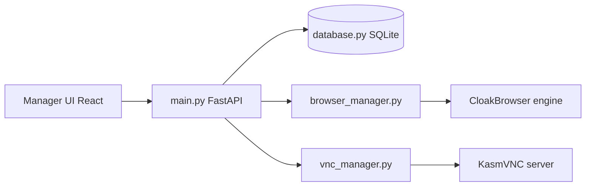

# CloakHQ/CloakBrowser-Manager

> Self-hosted manager of isolated browser profiles, each with its own fingerprint, proxy and cookies.

## The problem
Managing several accounts or browsing identities without cookies, fingerprint and network getting mixed, and without going through a cloud service billed per profile.

## What it actually does
- Creates persistent profiles: fingerprint seed, GPU, screen, timezone, language and proxy specific to each.
- Native windows on Windows/macOS; on Linux, Docker with KasmVNC display.
- Each profile exposes a CDP endpoint for Playwright or Puppeteer.
- The engine (CloakBrowser, a modified Chromium) is downloaded on first launch; the interface is declared MIT, but the repository's license is not identified.

## How it is wired


## Trying it
```bash
docker run -p 127.0.0.1:8080:8080 -v cloakprofiles:/data cloakhq/cloakbrowser-manager
# ou
git clone https://github.com/CloakHQ/CloakBrowser-Manager.git
cd CloakBrowser-Manager
docker compose up --build
```

## Cost and gotchas
Free with one simultaneous browser; beyond that, a paid license (key `CLOAKBROWSER_LICENSE_KEY`). About 512 MB of RAM per profile. Without `AUTH_TOKEN`, there is no authentication, and the token travels in clear text over HTTP. Early alpha project, unsigned installers.

## What it is not
It is not a neutral tool: its stated purpose is to make identities indistinguishable to the sites that check them, which may violate their terms of use. It is not fully free: the engine is a separate binary under a commercial license.

## Alternatives
The README cites Multilogin, GoLogin and AdsPower as commercial references (cloud services).

## For you
Ignore: little relation to everyday data/AI/MLOps work, unidentified license, proprietary engine and a use that carries legal risk.
