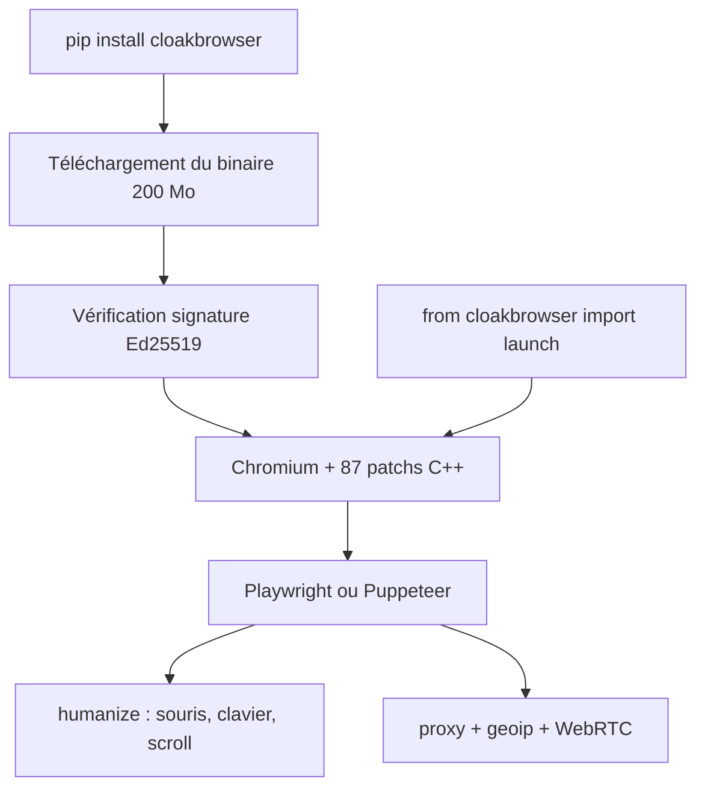

# CloakHQ/CloakBrowser

> Chromium modified at the C++ level so it is not detected as automated, with the Playwright API unchanged.

## The problem
Existing stealth tools inject JavaScript or change flags, and break with every Chrome update.
Anti-bot systems then detect the patches themselves.

## What it actually does
Provides a Chromium binary compiled with 87 patches at the C++ source level: canvas, WebGL, audio, fonts, GPU, screen, WebRTC, network timings, automation signals, CDP input behavior.
Replaces Playwright or Puppeteer by changing the import: `launch()`, `launch_context()`, `launch_persistent_context()` return standard Playwright objects.
`humanize=True` replaces clicks, keystrokes and scrolls with equivalents using Bézier curves and variable timings; `geoip=True` aligns timezone and locale with the proxy's exit IP and injects WebRTC IP spoofing.
Persistent profiles (cookies, localStorage, Chrome extensions, Widevine on Linux), native HTTP and SOCKS5 proxies, binary verified by Ed25519 signature before extraction.

## How it is wired


## Trying it
```bash
docker run --rm cloakhq/cloakbrowser cloaktest
pip install cloakbrowser
cloakbrowser login
python -m cloakbrowser info
```

## Cost and gotchas
The v146 binary remains free on GitHub Releases; the latest version requires a GitHub login (one concurrent session) and use at scale is paid (5 to 2,000+ sessions).
Residential proxies are not provided: separate bill. `geoip=True` triggers HTTP calls through your proxy to ipify.org and checkip.amazonaws.com.

## What it is not
It is not a CAPTCHA solver: the project aims to prevent them from appearing, not to solve them.
It is not proxy rotation: you bring your own.
It is not legally neutral: bypassing anti-bot protections makes you responsible with respect to the terms of service of the targeted sites, and the old free version degrades as detection evolves.

## Alternatives
- playwright-stealth — JavaScript injection; the README calls it obsolete and detectable.
- undetected-chromedriver — configuration patches on Selenium, without the Playwright API.
- puppeteer-extra — same family of injection-based approach.

## For you
Outside the data/AI scope and legally risky: ignore, unless there is an explicit anti-bot testing mandate.
