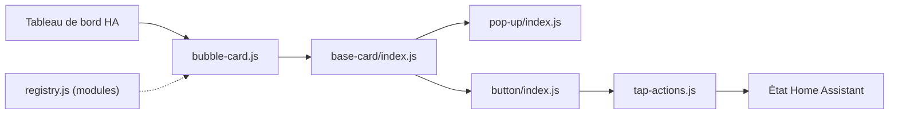

# Clooos/Bubble-Card

> Collection of customizable cards and pop-ups for Home Assistant dashboards.

## The problem
Default Home Assistant dashboards get cluttered quickly on mobile, with no pop-ups or compact, easily styled controls.

## What it actually does
A `custom:bubble-card` element, split into `card_type` variants: button (switch, slider, state, name), pop-up, horizontal-buttons-stack, media-player, climate, cover, calendar, select, separator.
Pop-ups are opened by URL hash (`#kitchen`) or triggered by an entity's state; since v3.2.0, the content is defined inside the pop-up (`cards`).
Styling through global or per-card CSS variables; visual editor inside Home Assistant; translations.
Built-in Module Store: more than 100 community modules.

## How it is wired


## Trying it
```bash
# Aucune commande shell dans le README.
# Installation via HACS (rechercher « Bubble Card »),
# ou copie de bubble-card.js dans /www puis ressource /local/bubble-card.js?v=1
```

## Cost and gotchas
Free; requires Home Assistant 2023.9.0 or newer. Without HACS, every update means changing the version in the resource URL, and sometimes clearing the browser cache.

## What it is not
Not a home automation integration: it controls no device itself, it displays and calls Home Assistant's services.
The horizontal-buttons-stack must be the last card of the view, outside any stack.
README truncated after the media-player options.

## Alternatives
No alternative named in the README.

## For you
Off-topic for data/AI: ignore, except for your personal home automation.
