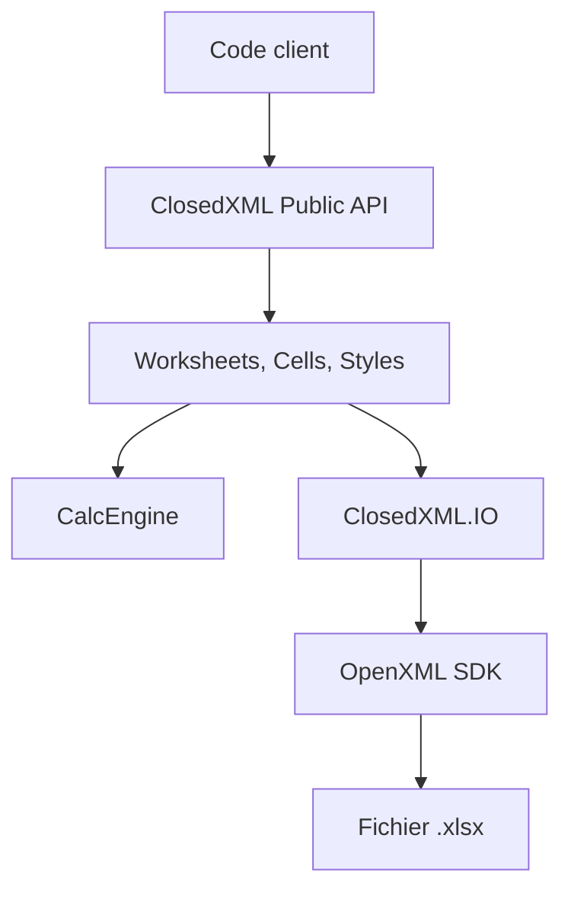

# ClosedXML/ClosedXML

> .NET library to read, edit and write Excel .xlsx files without Excel.

## The problem
Generating Excel reports on a server with the raw OpenXML API is heavy and verbose.

## What it actually does
A simple interface on top of OpenXML: workbooks, worksheets, cells, formulas, styles, tables, pivot tables, conditional formatting. The README's measurements: 1 million rows by 10 columns saved in 23 seconds using 1.9 GB of memory. Not thread-safe.

## How it is wired


## Trying it
```bash
PM> Install-Package ClosedXML
```

## Cost and gotchas
Free, NuGet package. A missing-fonts error is possible on a server with no fonts installed. Slow and memory-hungry loading for very large files (49 s and 801 MB for 1 million rows).

## What it is not
Not thread-safe. Not a tool for Python, nor a full spreadsheet calculation engine.

## Alternatives
No alternative named in the README (extensions ClosedXML.Report and ClosedXML.Extensions.*).

## For you
Ignore: .NET library, outside the usual Python stack of a data / AI / MLOps profile.
