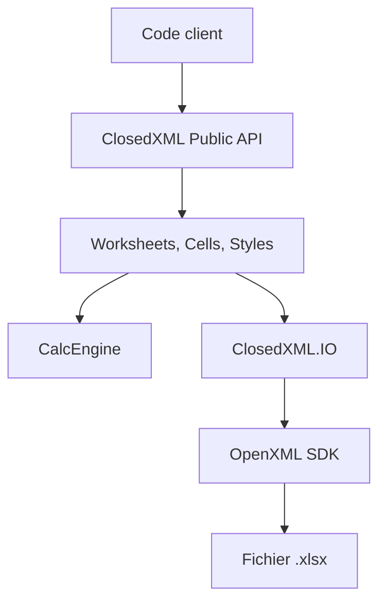

# ClosedXML/ClosedXML

> Bibliothèque .NET pour lire, modifier et écrire des fichiers Excel .xlsx sans Excel.

## Le problème
Générer des rapports Excel sur un serveur avec l'API OpenXML brute est lourd et verbeux.

## Ce que ça fait vraiment
Une interface simple au-dessus d'OpenXML : classeurs, feuilles, cellules, formules, styles, tableaux, tableaux croisés, mises en forme conditionnelles. Les mesures du README : 1 million de lignes sur 10 colonnes enregistrées en 23 secondes pour 1,9 Go de mémoire. Non thread-safe.

## Comment c'est branché


## Essayer
```bash
PM> Install-Package ClosedXML
```

## Coût et pièges
Gratuit, paquet NuGet. Erreur possible de polices manquantes sur serveur sans polices installées. Chargement lent et gourmand pour de très gros fichiers (49 s et 801 Mo pour 1 million de lignes).

## Ce que ce n'est pas
Pas thread-safe. Pas un outil pour Python ni un moteur de calcul tableur complet.

## Alternatives
Aucune alternative nommée dans le README (extensions ClosedXML.Report et ClosedXML.Extensions.*).

## Pour toi
Ignorer : bibliothèque .NET, hors pile Python habituelle d'un profil data / IA / MLOps.

