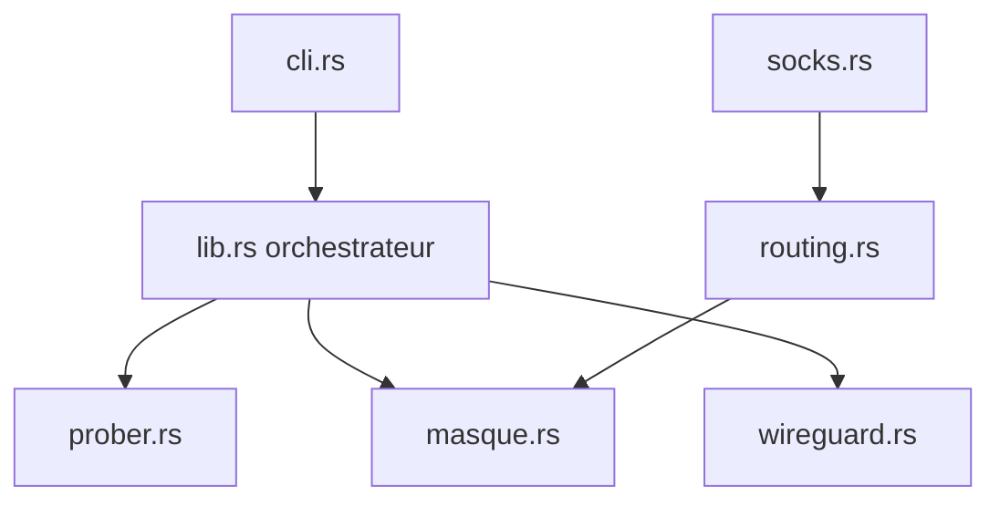

# CluvexStudio/Aether

> Censorship-circumvention client that opens an encrypted tunnel and a local SOCKS5 proxy.

## The problem
On restricted networks, packet inspection, access-point blocking and UDP throttling cut off classic VPNs.

## What it actually does
Discovers reachable gateways, checks that they pass traffic, then sets up a MASQUE tunnel (HTTP/3 or HTTP/2) or WireGuard, with nested variants and an optional Tor exit. A local SOCKS5 proxy on 127.0.0.1:1819 then serves applications, with routing rules and fast reconnection. The generated WARP identity depends on Cloudflare.

## How it is wired


## Trying it
```bash
./aether --masque -4 --scan turbo --noize firewall
curl -x socks5h://127.0.0.1:1819 https://www.cloudflare.com/cdn-cgi/trace
docker run -it -p 127.0.0.1:1819:1819 -v aether-data:/data ghcr.io/cluvexstudio/aether:latest
```

## Cost and gotchas
Free. The SOCKS5 proxy has no authentication: never expose it beyond 127.0.0.1. Without a volume, each launch creates a new device and Cloudflare throttles the bandwidth. macOS binaries are not notarized. AGPL-3.0 license.

## What it is not
Not a consumer VPN nor a guaranteed-anonymity tool: behavior depends on Cloudflare and the network.

## Alternatives
No alternative named in the README.

## For you
Ignore: network circumvention tool unrelated to your work and dependent on the WARP service; young project by a single author.
