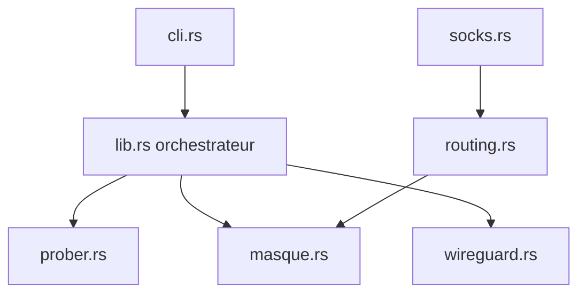

# CluvexStudio/Aether

> Client de contournement de la censure qui ouvre un tunnel chiffré et un proxy SOCKS5 local.

## Le problème
Dans les réseaux restreints, l'inspection de paquets, le blocage de points d'accès et le bridage UDP coupent les VPN classiques.

## Ce que ça fait vraiment
Découvre des passerelles accessibles, vérifie qu'elles font passer du trafic, puis monte un tunnel MASQUE (HTTP/3 ou HTTP/2) ou WireGuard, avec des variantes imbriquées et une sortie Tor optionnelle. Un proxy SOCKS5 local sur 127.0.0.1:1819 sert ensuite les applications, avec règles de routage et reconnexion rapide. L'identité WARP générée dépend de Cloudflare.

## Comment c'est branché


## Essayer
```bash
./aether --masque -4 --scan turbo --noize firewall
curl -x socks5h://127.0.0.1:1819 https://www.cloudflare.com/cdn-cgi/trace
docker run -it -p 127.0.0.1:1819:1819 -v aether-data:/data ghcr.io/cluvexstudio/aether:latest
```

## Coût et pièges
Gratuit. Le proxy SOCKS5 n'a pas d'authentification : ne jamais l'ouvrir hors de 127.0.0.1. Sans volume, chaque lancement crée un nouvel appareil et Cloudflare limite le débit. Binaires macOS non notariés. Licence AGPL-3.0.

## Ce que ce n'est pas
Pas un VPN grand public ni un outil d'anonymat garanti : le comportement dépend de Cloudflare et du réseau.

## Alternatives
Aucune alternative nommée dans le README.

## Pour toi
À ignorer : outil de contournement réseau sans lien avec ton travail et dépendant du service WARP ; projet jeune d'un seul auteur.

