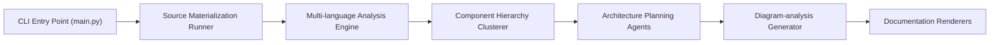

# CodeBoarding/CodeBoarding

> Generates architecture diagrams and documentation for a repository through static analysis and an LLM.

## The problem
Understanding a large repository, or checking what code agents produce, without rereading all the code.

## What it actually does
Language servers (LSP) build call graphs; a clusterer proposes a component hierarchy; LLM agents name and document it. Outputs are `.codeboarding/analysis.json` and then Markdown, HTML, MDX or reST with Mermaid. Modes `full`, `incremental`, `partial`. VS Code extension, GitHub Action, web platform.

## How it is wired


## Trying it
```bash
pipx install codeboarding --python python3.12
codeboarding-setup
codeboarding full --local /path/to/repo
codeboarding full --local /path/to/repo --render md
```

## Cost and gotchas
An LLM provider key (OpenAI, Anthropic, Google, Ollama, LiteLLM…) at your expense; Python 3.12 or 3.13. Downloads language servers (and a Node if absent). Telemetry is on by default (`CODEBOARDING_TELEMETRY=false`).

## What it is not
Not an exact survey of the code: names and groupings come from an LLM. The token cost grows with the size of the repository.

## Alternatives
No alternative named in the README.

## For you
Worth watching: handy for onboarding on an unfamiliar repository or documenting generated code; test it first on a small repository to measure the token cost.
