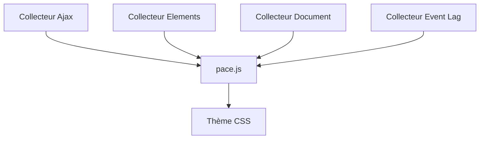

# CodeByZach/pace

> Automatic progress bar for web pages, dependency-free, included with a single line.

## The problem
Slow-loading pages give the user no visual feedback during ajax requests and rendering.

## What it actually does
Monitors four sources: ajax requests (XMLHttpRequest and WebSocket), present elements, document state and event-loop lag. Computes a percentage and displays it with a CSS theme of your choice. Restarts on every ajax navigation. Weighs 4 KB minified and compressed.

## How it is wired
Simplified diagram based on the fiche, no diagram provided.


## Trying it
```bash
<script src="https://cdn.jsdelivr.net/npm/pace-js@1/pace.min.js"></script>
<link rel="stylesheet" href="https://cdn.jsdelivr.net/npm/pace-js@1/pace-theme-default.min.css">
```
(HTML tags from the README, to be placed in `head`.)

## Cost and gotchas
Free. Options are read only once at load time: set them before the script. Only GET requests are tracked by default.

## What it is not
It is not a real server-side progress indicator: it is a visual estimate. Synchronous requests and link downloads are not tracked.

## Alternatives
- nprogress: cited as a source of inspiration, but progress is tracked manually.

## For you
Ignore: useful only if you build a web interface (dashboard, demo) for a model, and the benefit stays cosmetic.
