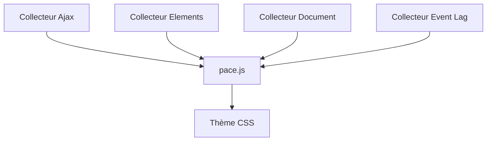

# CodeByZach/pace

> Barre de progression automatique pour pages web, sans dépendance, à inclure en une ligne.

## Le problème
Les pages à chargement lent n'affichent aucun retour visuel à l'utilisateur pendant les requêtes ajax et le rendu.

## Ce que ça fait vraiment
Surveille quatre sources : requêtes ajax (XMLHttpRequest et WebSocket), éléments présents, état du document et retard de la boucle d'événements. Calcule un pourcentage et l'affiche avec un thème CSS au choix. Redémarre à chaque navigation ajax. Pèse 4 ko minifié et compressé.

## Comment c'est branché
Schéma simplifié d'après la fiche, sans diagramme fourni.


## Essayer
```bash
<script src="https://cdn.jsdelivr.net/npm/pace-js@1/pace.min.js"></script>
<link rel="stylesheet" href="https://cdn.jsdelivr.net/npm/pace-js@1/pace-theme-default.min.css">
```
(Balises HTML du README, à placer dans `head`.)

## Coût et pièges
Gratuit. Les options se lisent une seule fois au chargement : les poser avant le script. Seules les requêtes GET sont suivies par défaut.

## Ce que ce n'est pas
Ce n'est pas un vrai indicateur de progression côté serveur : c'est une estimation visuelle. Les requêtes synchrones et les téléchargements par lien ne sont pas suivis.

## Alternatives
- nprogress : cité comme source d'inspiration, mais suivi manuel de la progression.

## Pour toi
À ignorer : utile seulement si tu construis une interface web (dashboard, démo) pour un modèle, et l'enjeu reste cosmétique.

