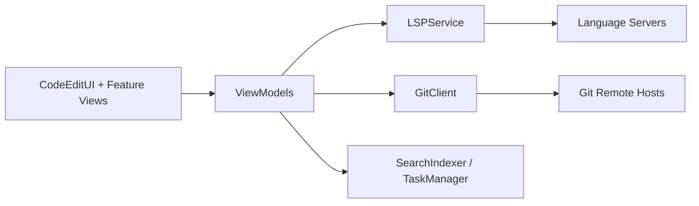

# CodeEditApp/CodeEdit

> Native macOS code editor written in Swift, developed by the community.

## The problem
Mainstream editors rely on Electron, and Xcode only suits Apple projects.

## What it is not
The README announces syntax highlighting, completion, search/replace, snippets, terminal, tasks, debugging, Git, code review and extensions; it states that the project is under development and not recommended for production.

## What it actually does
SwiftUI application in MVVM with one module per feature. According to the code: services for the LSP (language servers), Git, search indexing, tasks, the terminal emulator (SwiftTerm), the keychain; a Finder extension, shell integration scripts and update feed generation (AppCast).

## How it is wired

## Trying it
No command documented in the supplied README.

## Cost and gotchas
Free, macOS only. Not production-ready, according to its own README.

## What it is not
It is not cross-platform, nor a stable replacement for VS Code today.

## Alternatives
No alternative named in the README (Xcode is mentioned for comparison).

## For you
Ignore: unstabilized macOS editor, with no support for notebooks or the Python ecosystem mentioned in the README.
