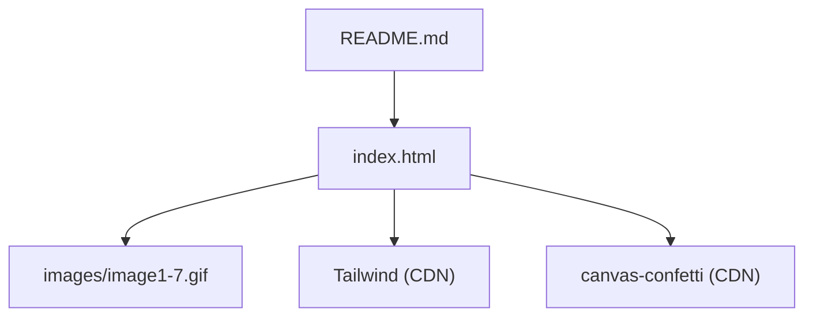

# CodeKageHQ/Ask-out-your-Valentine

> Fun interactive web page for asking someone to be your Valentine.

## The problem
Making an original request with a personalized page, without writing code.

## What it actually does
A single `index.html` page: the question with a GIF; the "No" button changes its text and enlarges the "Yes" button; "Yes" triggers a GIF and heart-shaped confetti. Tailwind CSS and canvas-confetti come from a CDN, with no build step.

## How it is wired


## Trying it
```bash
git clone https://github.com/CodeKageHQ/Ask-out-your-Valentine.git
# puis ouvrir index.html dans le navigateur
```

## Cost and gotchas
Free. Depends on CDNs for styling and confetti.

## What it is not
Not a professional tool: a hobby demo.

## Alternatives
No alternative named in the README.

## For you
Ignore: gadget unrelated to your work.
