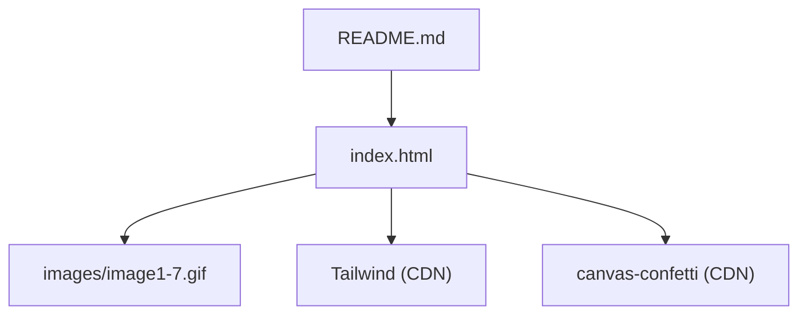

# CodeKageHQ/Ask-out-your-Valentine

> Page web interactive et amusante pour demander à quelqu'un d'être son Valentin.

## Le problème
Faire une demande originale avec une page personnalisée, sans écrire de code.

## Ce que ça fait vraiment
Une page unique `index.html` : la question avec un GIF, le bouton « Non » change de texte et agrandit le bouton « Oui », « Oui » déclenche un GIF et des confettis en cœurs. Tailwind CSS et canvas-confetti viennent d'un CDN, sans étape de build.

## Comment c'est branché


## Essayer
```bash
git clone https://github.com/CodeKageHQ/Ask-out-your-Valentine.git
# puis ouvrir index.html dans le navigateur
```

## Coût et pièges
Gratuit. Dépend de CDN pour le style et les confettis.

## Ce que ce n'est pas
Pas un outil professionnel : une démonstration de loisir.

## Alternatives
Aucune alternative nommée dans le README.

## Pour toi
Ignorer : gadget sans rapport avec ton travail.

