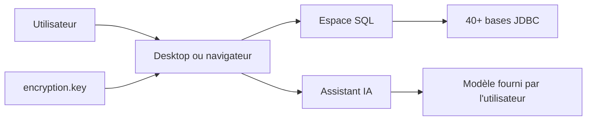

# CodePhiliaX/Chat2DB

> A local database client for 40+ DBMSs, with an AI assistant plugged into your own model.

## The problem
Writing, explaining and optimizing SQL across several different databases forces you to juggle clients and copy SQL into a chat.

## What it actually does
SQL workspace (editing, completion, formatting, history), metadata browsing, in-place data editing, import/export, dashboards and ER diagrams, plus an open source CLI with MCP support. The AI assistant generates, explains and optimizes SQL with a model you provide. Database passwords and AI API keys are encrypted with AES-256-GCM using one key per installation.

## How it is wired


## Trying it
```bash
git clone https://github.com/OtterMind/Chat2DB.git && cd Chat2DB
./script/security/init-community-encryption-key.sh
docker compose --file docker/docker-compose.yml up --detach
# puis ouvrir http://localhost:10825
```

## Cost and gotchas
The application is free, but the AI model is at your expense (API key). Docker 19.03+, 2 cores, 4 GiB of RAM. Losing ~/.config/chat2db-community/encryption.key makes stored secrets unreadable. Single-user application: bind it to 127.0.0.1, never expose it. Custom JDBC drivers are executable Java code.

## What it is not
Not a multi-user service nor a tool to expose on a network. No AI included: you must connect your own model. Version 5.4.0-beta.1 (local "Pi Agent") is a preview, not the stable release.

## Alternatives
None named in the README.

## For you
Worth watching: handy for querying several databases with an AI of your choice, but the license must be checked (not identified by GitHub) before any professional use.
