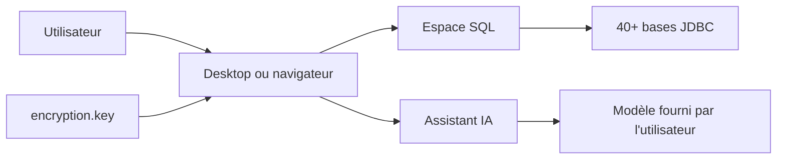

# CodePhiliaX/Chat2DB

> Client de bases de données local pour plus de 40 SGBD, avec assistant IA branché sur ton propre modèle.

## Le problème
Écrire, expliquer et optimiser du SQL sur plusieurs bases différentes oblige à jongler entre clients et à copier du SQL vers un chat.

## Ce que ça fait vraiment
Espace de travail SQL (édition, complétion, formatage, historique), navigation des métadonnées, édition de données en place, import/export, tableaux de bord et diagrammes ER, plus un CLI open source avec support MCP. L'assistant IA génère, explique et optimise du SQL avec un modèle que tu fournis. Les mots de passe des bases et les clés d'API IA sont chiffrés en AES-256-GCM avec une clé par installation.

## Comment c'est branché


## Essayer
```bash
git clone https://github.com/OtterMind/Chat2DB.git && cd Chat2DB
./script/security/init-community-encryption-key.sh
docker compose --file docker/docker-compose.yml up --detach
# puis ouvrir http://localhost:10825
```

## Coût et pièges
Application gratuite, mais le modèle IA est à ta charge (clé d'API). Docker 19.03+, 2 cœurs, 4 Gio de RAM. Perdre ~/.config/chat2db-community/encryption.key rend les secrets stockés illisibles. Application mono-utilisateur : à lier à 127.0.0.1, jamais exposée. Les pilotes JDBC personnalisés sont du code Java exécutable.

## Ce que ce n'est pas
Pas un service multi-utilisateurs ni un outil à exposer sur un réseau. Pas d'IA incluse : il faut connecter son modèle. La version 5.4.0-beta.1 (agent local « Pi Agent ») est un aperçu, pas la version stable.

## Alternatives
Aucune nommée dans le README.

## Pour toi
À surveiller : pratique pour interroger plusieurs bases avec une IA de ton choix, mais la licence est à vérifier (non identifiée par GitHub) avant tout usage pro.

