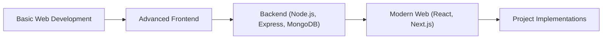

# CodeWithHarry/Sigma-Web-Dev-Course

> Source code of a web development course in Hindi, for beginners.

## The problem
Beginners who prefer Hindi lack web development courses in their own language.

## What it actually does
Code repository accompanying a YouTube playlist: HTML, CSS and JavaScript basics, then front-end, back-end and databases. Based on the architecture described: Node.js, Express, MongoDB, React, Next.js, and projects (Spotify Clone, password manager, URL shortener, LinkTree).

## How it is wired

## Trying it
No command in the README; the link points to the YouTube playlist.

## Cost and gotchas
Free. No license declared: use of the code is not explicitly permitted. Last push on 2024-11-05.

## What it is not
Not a library or a tool: it is educational content, and the README's promise of daily updates is no longer kept.

## Alternatives
No alternative named in the README.

## For you
Ignore: general-purpose web course in Hindi, off-topic for data/AI, with no license and no update for over a year.
